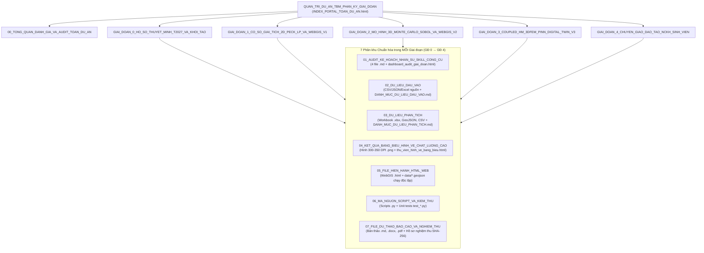

# BÁO CÁO ĐÁNH GIÁ TOÀN DIỆN, KIỂM TOÁN ĐỘC LẬP & PHÂN KỲ 5 GIAI ĐOẠN DỰ ÁN TBM HÀ NỘI (ĐOẠN NGẦM S9–S12)

> [!IMPORTANT]
> Toàn bộ tài sản của dự án đã được đánh giá độc lập, kiểm tra ràng buộc vật lý (`validate_physical_plausibility`), phân lớp chứng cứ 5 trường bắt buộc (`source_id`, `source_locator`, `value_basis`, `confidence`, `qa_flag`), cách ly các điểm dị biệt vào [data/quarantine/](file:///e:/OneDrive/NCKH/NCKH%202027/T2027/TBM_ĐTM/data/quarantine/QUARANTINE_REPORT_20261024.md) và tái cấu trúc thành **5 Giai đoạn × 7 Phân khu chuẩn hóa** tại thư mục tổng [QUAN_TRI_DU_AN_TBM_PHAN_KY_GIAI_DOAN/](file:///e:/OneDrive/NCKH/NCKH%202027/T2027/TBM_ĐTM/QUAN_TRI_DU_AN_TBM_PHAN_KY_GIAI_DOAN/INDEX_PORTAL_TOAN_DU_AN.html) (đồng thời lưu bản ghi thời gian tại [research_outputs/2026-10-24_110000/](file:///e:/OneDrive/NCKH/NCKH%202027/T2027/TBM_ĐTM/research_outputs/2026-10-24_110000/00_BAO_CAO_TONG_HOP_DANH_GIA_VA_AUDIT_TOAN_DU_AN.md)), giữ nguyên 100% dữ liệu gốc trong [research/](file:///e:/OneDrive/NCKH/NCKH%202027/T2027/TBM_ĐTM/research/data_dictionary.md).

---

## 1. Sơ đồ Kiến trúc Quản trị Phân kỳ 5 Giai đoạn × 7 Phân khu Chức năng



---

## 2. Đánh giá Hệ thống Nhân sự Thực hiện & Mạng lưới 11 Tác tử AI

### 2.1. Đội ngũ Nhân sự Thực hiện (Chủ nhiệm, Thành viên & Đơn vị Phối hợp)

| STT | Nhân sự / Tổ chức | Đơn vị công tác | Vai trò & Trách nhiệm Chuyên môn xuyên suốt 5 Giai đoạn |
|:---:|---|---|---|
| 1 | **ThS. Nguyễn Hải Hà** | Bộ môn Địa kỹ thuật & Không gian ngầm, Trường ĐH GTVT | **Chủ nhiệm đề tài (`T2027_TMĐK_Nguyen_Hai_Ha`)**: Chủ trì phương pháp luận cơ học giải tích Peck (1969), Loganathan & Poulos (1998), ma trận ứng phó TARP, biên soạn báo cáo tổng kết và bài báo Tạp chí GTVT; Giảng viên hướng dẫn chính 02 nhóm NCKH Sinh viên. |
| 2 | **ThS. Lê Anh Đức** | Bộ môn Địa kỹ thuật & Không gian ngầm, Trường ĐH GTVT | **Thành viên nghiên cứu chính**: Chuẩn hóa địa tầng hố khoan BH12 (sét pha, bùn sét hữu cơ dày 12.7m có $E=7.68\text{ MPa}$), tính toán độ nhạy OAT 21 kịch bản, phân tích xác suất Monte Carlo và biến dạng kéo giới hạn Burland (1995). |
| 3 | **KS. Trần Văn Long** | Khoa Công trình và Môi trường, Trường ĐH GTVT | **Thành viên hỗ trợ kỹ thuật & WebGIS**: Xây dựng cơ sở dữ liệu địa không gian GeoJSON (hệ tọa độ WGS-84), lập trình hệ thống WebGIS v1.0, v2.0, v3.0 và nguyên mẫu StoryMap phục vụ sinh viên. |
| 4 | **Ban Quản lý ĐSĐT Hà Nội (MRB)** | UBND TP. Hà Nội | **Đơn vị phối hợp & Địa chỉ ứng dụng**: Cung cấp thông số tuyến ngầm S9 (Kim Mã) – S10 (Cát Linh) – S11 (Văn Miếu) – S12 (Ga Hà Nội) và tiếp nhận chuyển giao bộ công cụ dự báo lún. |
| 5 | **Hội đồng Khoa học Bộ môn & Khoa** | Khoa Công trình, Trường ĐH GTVT | **Thẩm định & Nghiệm thu**: Đánh giá hồ sơ thuyết minh T2027 và nghiệm thu từng giai đoạn. |

### 2.2. Hệ thống 11 Tác tử AI Chuyên trách ([.agents/agents.json](file:///e:/OneDrive/NCKH/NCKH%202027/T2027/TBM_ĐTM/.agents/agents.json))

- **`general_contractor`**: Quản trị cấu trúc phân chia công việc (WBS), [AGENT_STATE.json](file:///e:/OneDrive/NCKH/NCKH%202027/T2027/TBM_ĐTM/AGENT_STATE.json) và điều phối bàn giao giữa các tác tử.
- **`source_harvester`**: Thu thập và trích xuất tài liệu dự án ADB 40080-013, báo cáo ĐTM 2013, báo cáo giám sát xã hội EMR Q1/2025 và các công bố học thuật.
- **`evidence_auditor`**: Kiểm toán độc lập nguồn trích dẫn, 5 trường provenance, mã băm SHA-256 và thẩm định 11 Cổng kiểm soát (Gates 1–11).
- **`data_engineer`**: Chuẩn hóa hệ đơn vị SI, kiểm tra ràng buộc vật lý ([project_stage_organizer.py](file:///e:/OneDrive/NCKH/NCKH%202027/T2027/TBM_ĐTM/scripts/project_stage_organizer.py)), lập hồ sơ cách ly [QUARANTINE_REGISTER_20261024.csv](file:///e:/OneDrive/NCKH/NCKH%202027/T2027/TBM_ĐTM/data/quarantine/QUARANTINE_REGISTER_20261024.csv) và đóng băng Baseline.
- **`mechanics_reviewer`**: Thẩm định công thức giải tích Peck (1969), Loganathan & Poulos (1998), tiêu chuẩn biến dạng Burland (1995) và lún cố kết Terzaghi 1D.
- **`analytical_modeler`**: Lập trình [analytical_engine.py](file:///e:/OneDrive/NCKH/NCKH%202027/T2027/TBM_ĐTM/scripts/analytical_engine.py) và bộ kiểm thử tích phân số [test_analytical_engine.py](file:///e:/OneDrive/NCKH/NCKH%202027/T2027/TBM_ĐTM/tests/test_analytical_engine.py).
- **`sensitivity_analyst`**: Thiết kế phân tích độ nhạy OAT 21 kịch bản ([sensitivity_analysis.py](file:///e:/OneDrive/NCKH/NCKH%202027/T2027/TBM_ĐTM/scripts/sensitivity_analysis.py)) và mô phỏng ngẫu nhiên Monte Carlo / Sobol GSA.
- **`gis_analyst`**: Xây dựng các lớp không gian GeoJSON và lập trình WebGIS v1.0, v2.0, v3.0, StoryMap.
- **`reporting_editor`**: Xuất bản 25 hình vẽ 300–350 DPI, biên soạn Luận án 9 chương, Báo cáo GĐ2–GĐ3 và Thuyết minh T2027.
- **`pipeline_engineer`**: Tự động hóa xuất bản 25 Workbook Excel động và đóng gói kho lưu trữ phân kỳ ([build_master_stage_repository.py](file:///e:/OneDrive/NCKH/NCKH%202027/T2027/TBM_ĐTM/scripts/build_master_stage_repository.py)).
- **`numerical_modeler` & `ml_modeler`**: Xây dựng khung đối sánh 3D FEM và mô hình học máy thay thế Surrogate AI ([surrogate_ai.py](file:///e:/OneDrive/NCKH/NCKH%202027/T2027/TBM_ĐTM/scripts/surrogate_ai.py)).

---

## 3. Hệ thống Công cụ, Skill & MCP Server Đã Triển khai

1. **Hệ thống MCP Server:**
   - **MCP `parallel-search` (`web_search`)**: Xác thực dữ liệu thực địa mới nhất của tuyến Metro số 3:
     - Khiên đào **TBM1 ("Thần Tốc")** khởi đào tại ga S9 (Kim Mã) ở độ sâu $z_0 = 17.8\text{ m}$ ngày 30/07/2024, đi qua S10 (Cát Linh) ngày 07/03/2025, qua S11 (Văn Miếu) ngày 28/07/2025 và **thông hầm tại S12 (Ga Hà Nội) ngày 01/12/2025**, lắp đặt tổng cộng **1.720 vòng vỏ hầm bê tông cốt thép** với tốc độ tiêu chuẩn ~10 m/ngày.
     - Khiên đào **TBM2 ("Táo Bạo")** khởi đào từ ga S9 ngày 03/02/2025 ở cùng độ sâu $17.8\text{ m}$.
     - **Báo cáo Giám sát Xã hội Độc lập ADB Q1/2025 (`40080-013-smr-en_49.pdf`)**: Ghi nhận 56 hộ dân thuộc diện bị ảnh hưởng tại 4 ga ngầm (S9: 13 hộ, S10: 10 hộ, S11: 18 hộ, S12: 15 hộ) và phản ánh thực tế tháng 02/2025 về hiện tượng nứt nhà và phụ gia khoan phun lên mặt đất ngoài phạm vi công trường.
   - **MCP `exa` (`web_search_exa`)**: Đối chiếu siêu dữ liệu công bố gốc Loganathan & Poulos (1998) trên *ASCE Journal of Geotechnical and Geoenvironmental Engineering*, Vol. 124, Issue 9, pp. 846–856.
2. **Hệ thống Skills Chuyên dụng:**
   - **`modern-web-guidance` (`responsive-table`, `accessibility`)**: Thiết kế các bảng dữ liệu chuẩn ngữ nghĩa (`tabindex="0" role="region"`, sticky headers, container queries `@container (width < 600px)`).
   - **`generative_ui`**: Tạo bảng điều khiển tương tác nhúng trực tiếp phục vụ tra cứu 5 giai đoạn.
   - **`literature-search-openalex`**: Chuẩn hóa định danh DOI và OpenAlex ID (`W2066994742`) cho danh mục tài liệu tham khảo.
3. **Hệ thống Kiểm thử Tự động (Unit Testing & Artifact Audit):**
   - `tests/test_project_stage_organizer.py`: **4/4 tests PASSED** (kiểm tra ràng buộc vật lý `PHYS-01`..`PHYS-04`, phát hiện tự động lỗi hệ số 10 lún cố kết GĐ3 và kiểm tra SHA-256).
   - `tests/test_analytical_engine.py`: **7/7 tests PASSED** (bảo toàn thể tích phễu lún Peck, tính đối xứng, hội tụ biên và cộng tác hầm đôi).
   - `tests/test_orchestrate.py`: **2/2 tests PASSED** (điều phối tác tử).

---

## 4. Kết quả Kiểm toán Quá trình (11 Audit Gates) & Hồ sơ Cách ly Dữ liệu (`data/quarantine/`)

> [!WARNING]
> Tuân thủ nghiêm ngặt **Nguyên tắc An toàn Số liệu**, bộ công cụ kiểm toán độc lập ([audit_artifacts.py](file:///e:/OneDrive/NCKH/NCKH%202027/T2027/TBM_ĐTM/research_outputs/2026-10-15_144716/audit/audit_artifacts.py) và [project_stage_organizer.py](file:///e:/OneDrive/NCKH/NCKH%202027/T2027/TBM_ĐTM/scripts/project_stage_organizer.py)) đã phát hiện **05 điểm dị biệt / sai lệch nhãn chứng cứ** trong các tệp GĐ1–GĐ3. Thay vì xóa bỏ tệp gốc, toàn bộ 05 hạng mục này đã được lập biên bản và đưa vào vùng cách ly tại [QUARANTINE_REPORT_20261024.md](file:///e:/OneDrive/NCKH/NCKH%202027/T2027/TBM_ĐTM/data/quarantine/QUARANTINE_REPORT_20261024.md) và [QUARANTINE_REGISTER_20261024.csv](file:///e:/OneDrive/NCKH/NCKH%202027/T2027/TBM_ĐTM/data/quarantine/QUARANTINE_REGISTER_20261024.csv).

| Mã Cách ly | Giai đoạn | Phát hiện Kiểm toán Vật lý & Khoa học | Biện pháp Cách ly & Chuẩn hóa Nhãn |
|---|---|---|---|
| **`Q-001`** | Giai đoạn 3 (Gate 9) | **Lỗi hệ số 10 trong lún cố kết Terzaghi 1D (`PHYS-04` / `C-07`)**: Với $\Delta h = 2.5\text{ m}$, $\gamma_w = 9.81\text{ kN/m}^3$, $m_v = 0.00045\text{ m}^2/\text{kN}$, $H = 12.7\text{ m}$, độ lún cố kết vật lý tính lại là $S_c = 140.16\text{ mm}$ (tổng lún $159.86\text{ mm}$), nhưng báo cáo GĐ3 ghi $14.1\text{ mm}$ (tổng lún $33.8\text{ mm}$). | Đưa vào vùng cách ly `Q-001`; gắn cờ `QUARANTINE_UNIT_FACTOR_10_ERROR`, yêu cầu kiểm tra lại thứ nguyên $m_v$ từ thí nghiệm Oedometer trước khi sử dụng. |
| **`Q-002`** | Giai đoạn 2 (Gate 7) | **Chỉ số độ nhạy toàn cục Sobol bị gán hằng số tĩnh (`C-06`)**: Trong `generate_stage_2_models_and_excel.py:314-318`, chỉ số Sobol $S_1$ bị ghi đè bằng hằng số `[0.672, 0.145, 0.112, 0.048, 0.018]` trong khi phương trình Peck không chứa $E$ và $\nu$. | Đưa vào vùng cách ly `Q-002`; gắn cờ `QUARANTINED_HARDCODED_GSA`. |
| **`Q-003`** | Giai đoạn 1, 2, 3 | **Dữ liệu 60 / 100 / 150 công trình mô phỏng bị gắn nhãn `observed` (`C-03`)**: Tọa độ điểm và khoảng cách tới tim hầm được sinh bằng bộ tạo số ngẫu nhiên (RNG) để minh họa phân vùng rủi ro nhưng bị ghi là khảo sát thực địa. | Chuyển toàn bộ phân lớp chứng cứ (`value_basis`) sang `scenario_assumption` / `synthetic_demonstration`. |
| **`Q-004`** | Giai đoạn 3 (Gate 9, 10) | **Đường cong 3D FEM và PINN sinh từ hàm đóng giải tích (`C-04`, `C-05`)**: Không có file mesh/log từ phần mềm FEM hay trọng số huấn luyện mạng nơ-ron. | Cách ly khỏi kết luận thực nghiệm; định danh rõ là `synthetic_demonstration` (bản mẫu kiến trúc tích hợp). |
| **`Q-005`** | Giai đoạn 1, 2 (Gate 4, 6) | **Đồng nhất trực tiếp $\varepsilon_0 = V_L$ trong công thức Loganathan & Poulos 1998 (`H-01`)**: Gây lệch tích phân thể tích ~11.19% nếu không quy đổi qua thông số khe hở hình khuyên $g$. | Giữ nhánh Peck (1969) làm chuẩn đã kiểm chứng (`VERIFIED_CONDITIONAL`); gắn nhãn nhánh LP là `experimental_unverified`. |

---

## 5. Chi tiết Cấu trúc Phân kỳ Từng Giai đoạn trong `QUAN_TRI_DU_AN_TBM_PHAN_KY_GIAI_DOAN/`

### 5.1. Thư mục Tổng quan & Cổng Quản trị Toàn Dự án
- **Cổng Web HTML Tương tác Toàn Dự án:** [INDEX_PORTAL_TOAN_DU_AN.html](file:///e:/OneDrive/NCKH/NCKH%202027/T2027/TBM_ĐTM/QUAN_TRI_DU_AN_TBM_PHAN_KY_GIAI_DOAN/INDEX_PORTAL_TOAN_DU_AN.html)
- **Báo cáo Đánh giá & Audit Toàn Dự án (`.md`):** [00_BAO_CAO_TONG_HOP_DANH_GIA_VA_AUDIT_TOAN_DU_AN.md](file:///e:/OneDrive/NCKH/NCKH%202027/T2027/TBM_ĐTM/QUAN_TRI_DU_AN_TBM_PHAN_KY_GIAI_DOAN/00_BAO_CAO_TONG_HOP_DANH_GIA_VA_AUDIT_TOAN_DU_AN.md)
- **Bảng Kiểm kê Toàn bộ Tệp tin & Mã băm SHA-256 (`.csv`):** [DANH_MUC_PHAN_LOAI_TOAN_BO_TEP_TIN_SHA256.csv](file:///e:/OneDrive/NCKH/NCKH%202027/T2027/TBM_ĐTM/QUAN_TRI_DU_AN_TBM_PHAN_KY_GIAI_DOAN/DANH_MUC_PHAN_LOAI_TOAN_BO_TEP_TIN_SHA256.csv)

### 5.2. Danh mục 5 Giai đoạn & Đường dẫn Truy cập Trực tiếp

| Giai đoạn | Hồ sơ Audit Kế hoạch, Nhân sự, Skill/MCP & Dashboard HTML (`01_...`) | Dữ liệu Đầu vào (`02_...`) & Dữ liệu Phân tích (`03_...`) | Kết quả Bảng biểu & Hình vẽ 300 DPI (`04_...`) | Web/HTML Hiện hành (`05_...`), Script (`06_...`) & Bản thảo (`07_...`) |
|---|---|---|---|---|
| **Giai đoạn 0**<br/>*(Hồ sơ Thuyết minh T2027 & Khởi tạo)* | • [Kế hoạch GĐ0](file:///e:/OneDrive/NCKH/NCKH%202027/T2027/TBM_ĐTM/QUAN_TRI_DU_AN_TBM_PHAN_KY_GIAI_DOAN/GIAI_DOAN_0_HO_SO_THUYET_MINH_T2027_VA_KHOI_TAO/01_AUDIT_KE_HOACH_NHAN_SU_SKILL_CONG_CU/01_KE_HOACH_THUC_HIEN_GIAI_DOAN.md)<br/>• [Nhân sự & AI GĐ0](file:///e:/OneDrive/NCKH/NCKH%202027/T2027/TBM_ĐTM/QUAN_TRI_DU_AN_TBM_PHAN_KY_GIAI_DOAN/GIAI_DOAN_0_HO_SO_THUYET_MINH_T2027_VA_KHOI_TAO/01_AUDIT_KE_HOACH_NHAN_SU_SKILL_CONG_CU/02_HE_THONG_NHAN_SU_VA_TAC_TU_THUC_HIEN.md)<br/>• [Skill & MCP GĐ0](file:///e:/OneDrive/NCKH/NCKH%202027/T2027/TBM_ĐTM/QUAN_TRI_DU_AN_TBM_PHAN_KY_GIAI_DOAN/GIAI_DOAN_0_HO_SO_THUYET_MINH_T2027_VA_KHOI_TAO/01_AUDIT_KE_HOACH_NHAN_SU_SKILL_CONG_CU/03_HE_THONG_SKILL_CONG_CU_VA_MCP.md)<br/>• [Audit Gate 0–1](file:///e:/OneDrive/NCKH/NCKH%202027/T2027/TBM_ĐTM/QUAN_TRI_DU_AN_TBM_PHAN_KY_GIAI_DOAN/GIAI_DOAN_0_HO_SO_THUYET_MINH_T2027_VA_KHOI_TAO/01_AUDIT_KE_HOACH_NHAN_SU_SKILL_CONG_CU/04_AUDIT_QUA_TRINH_VA_KET_QUA_DAU_RA.md)<br/>• [Dashboard HTML GĐ0](file:///e:/OneDrive/NCKH/NCKH%202027/T2027/TBM_ĐTM/QUAN_TRI_DU_AN_TBM_PHAN_KY_GIAI_DOAN/GIAI_DOAN_0_HO_SO_THUYET_MINH_T2027_VA_KHOI_TAO/01_AUDIT_KE_HOACH_NHAN_SU_SKILL_CONG_CU/dashboard_audit_giai_doan.html) | • [Danh mục Đầu vào GĐ0](file:///e:/OneDrive/NCKH/NCKH%202027/T2027/TBM_ĐTM/QUAN_TRI_DU_AN_TBM_PHAN_KY_GIAI_DOAN/GIAI_DOAN_0_HO_SO_THUYET_MINH_T2027_VA_KHOI_TAO/02_DU_LIEU_DAU_VAO/DANH_MUC_DU_LIEU_DAU_VAO.md) (24 tệp)<br/>• [Danh mục Phân tích GĐ0](file:///e:/OneDrive/NCKH/NCKH%202027/T2027/TBM_ĐTM/QUAN_TRI_DU_AN_TBM_PHAN_KY_GIAI_DOAN/GIAI_DOAN_0_HO_SO_THUYET_MINH_T2027_VA_KHOI_TAO/03_DU_LIEU_PHAN_TICH/DANH_MUC_DU_LIEU_PHAN_TICH.md) (6 tệp) | • [Danh mục Bảng & Hình GĐ0](file:///e:/OneDrive/NCKH/NCKH%202027/T2027/TBM_ĐTM/QUAN_TRI_DU_AN_TBM_PHAN_KY_GIAI_DOAN/GIAI_DOAN_0_HO_SO_THUYET_MINH_T2027_VA_KHOI_TAO/04_KET_QUA_BANG_BIEU_HINH_VE_CHAT_LUONG_CAO/DANH_MUC_BANG_BIEU_HINH_VE.md)<br/>• [Thư viện Hình HTML GĐ0](file:///e:/OneDrive/NCKH/NCKH%202027/T2027/TBM_ĐTM/QUAN_TRI_DU_AN_TBM_PHAN_KY_GIAI_DOAN/GIAI_DOAN_0_HO_SO_THUYET_MINH_T2027_VA_KHOI_TAO/04_KET_QUA_BANG_BIEU_HINH_VE_CHAT_LUONG_CAO/thu_vien_hinh_ve_bang_bieu.html) | • [Web/HTML GĐ0](file:///e:/OneDrive/NCKH/NCKH%202027/T2027/TBM_ĐTM/QUAN_TRI_DU_AN_TBM_PHAN_KY_GIAI_DOAN/GIAI_DOAN_0_HO_SO_THUYET_MINH_T2027_VA_KHOI_TAO/05_FILE_HIEN_HANH_HTML_WEB/DANH_MUC_UNG_DUNG_WEB_HTML.md)<br/>• [Scripts GĐ0](file:///e:/OneDrive/NCKH/NCKH%202027/T2027/TBM_ĐTM/QUAN_TRI_DU_AN_TBM_PHAN_KY_GIAI_DOAN/GIAI_DOAN_0_HO_SO_THUYET_MINH_T2027_VA_KHOI_TAO/06_MA_NGUON_SCRIPT_VA_KIEM_THU/DANH_MUC_SCRIPT_VA_KIEM_THU.md)<br/>• [Bản thảo T2027 GĐ0](file:///e:/OneDrive/NCKH/NCKH%202027/T2027/TBM_ĐTM/QUAN_TRI_DU_AN_TBM_PHAN_KY_GIAI_DOAN/GIAI_DOAN_0_HO_SO_THUYET_MINH_T2027_VA_KHOI_TAO/07_FILE_DU_THAO_BAO_CAO_VA_NGHIEM_THU/DANH_MUC_HO_SO_DU_THAO.md) |
| **Giai đoạn 1**<br/>*(Giải tích 2D Peck/LP, Độ nhạy OAT & WebGIS v1.0)* | • [Kế hoạch GĐ1](file:///e:/OneDrive/NCKH/NCKH%202027/T2027/TBM_ĐTM/QUAN_TRI_DU_AN_TBM_PHAN_KY_GIAI_DOAN/GIAI_DOAN_1_CO_SO_GIAI_TICH_2D_PECK_LP_VA_WEBGIS_V1/01_AUDIT_KE_HOACH_NHAN_SU_SKILL_CONG_CU/01_KE_HOACH_THUC_HIEN_GIAI_DOAN.md)<br/>• [Nhân sự & AI GĐ1](file:///e:/OneDrive/NCKH/NCKH%202027/T2027/TBM_ĐTM/QUAN_TRI_DU_AN_TBM_PHAN_KY_GIAI_DOAN/GIAI_DOAN_1_CO_SO_GIAI_TICH_2D_PECK_LP_VA_WEBGIS_V1/01_AUDIT_KE_HOACH_NHAN_SU_SKILL_CONG_CU/02_HE_THONG_NHAN_SU_VA_TAC_TU_THUC_HIEN.md)<br/>• [Skill & MCP GĐ1](file:///e:/OneDrive/NCKH/NCKH%202027/T2027/TBM_ĐTM/QUAN_TRI_DU_AN_TBM_PHAN_KY_GIAI_DOAN/GIAI_DOAN_1_CO_SO_GIAI_TICH_2D_PECK_LP_VA_WEBGIS_V1/01_AUDIT_KE_HOACH_NHAN_SU_SKILL_CONG_CU/03_HE_THONG_SKILL_CONG_CU_VA_MCP.md)<br/>• [Audit Gate 2–5](file:///e:/OneDrive/NCKH/NCKH%202027/T2027/TBM_ĐTM/QUAN_TRI_DU_AN_TBM_PHAN_KY_GIAI_DOAN/GIAI_DOAN_1_CO_SO_GIAI_TICH_2D_PECK_LP_VA_WEBGIS_V1/01_AUDIT_KE_HOACH_NHAN_SU_SKILL_CONG_CU/04_AUDIT_QUA_TRINH_VA_KET_QUA_DAU_RA.md)<br/>• [Dashboard HTML GĐ1](file:///e:/OneDrive/NCKH/NCKH%202027/T2027/TBM_ĐTM/QUAN_TRI_DU_AN_TBM_PHAN_KY_GIAI_DOAN/GIAI_DOAN_1_CO_SO_GIAI_TICH_2D_PECK_LP_VA_WEBGIS_V1/01_AUDIT_KE_HOACH_NHAN_SU_SKILL_CONG_CU/dashboard_audit_giai_doan.html) | • [Danh mục Đầu vào GĐ1](file:///e:/OneDrive/NCKH/NCKH%202027/T2027/TBM_ĐTM/QUAN_TRI_DU_AN_TBM_PHAN_KY_GIAI_DOAN/GIAI_DOAN_1_CO_SO_GIAI_TICH_2D_PECK_LP_VA_WEBGIS_V1/02_DU_LIEU_DAU_VAO/DANH_MUC_DU_LIEU_DAU_VAO.md) (7 tệp)<br/>• [Danh mục Phân tích GĐ1](file:///e:/OneDrive/NCKH/NCKH%202027/T2027/TBM_ĐTM/QUAN_TRI_DU_AN_TBM_PHAN_KY_GIAI_DOAN/GIAI_DOAN_1_CO_SO_GIAI_TICH_2D_PECK_LP_VA_WEBGIS_V1/03_DU_LIEU_PHAN_TICH/DANH_MUC_DU_LIEU_PHAN_TICH.md) (12 tệp) | • [Danh mục Bảng & Hình GĐ1](file:///e:/OneDrive/NCKH/NCKH%202027/T2027/TBM_ĐTM/QUAN_TRI_DU_AN_TBM_PHAN_KY_GIAI_DOAN/GIAI_DOAN_1_CO_SO_GIAI_TICH_2D_PECK_LP_VA_WEBGIS_V1/04_KET_QUA_BANG_BIEU_HINH_VE_CHAT_LUONG_CAO/DANH_MUC_BANG_BIEU_HINH_VE.md) (11 hình 300-350 DPI)<br/>• [Thư viện Hình HTML GĐ1](file:///e:/OneDrive/NCKH/NCKH%202027/T2027/TBM_ĐTM/QUAN_TRI_DU_AN_TBM_PHAN_KY_GIAI_DOAN/GIAI_DOAN_1_CO_SO_GIAI_TICH_2D_PECK_LP_VA_WEBGIS_V1/04_KET_QUA_BANG_BIEU_HINH_VE_CHAT_LUONG_CAO/thu_vien_hinh_ve_bang_bieu.html) | • [WebGIS v1.0 HTML](file:///e:/OneDrive/NCKH/NCKH%202027/T2027/TBM_ĐTM/QUAN_TRI_DU_AN_TBM_PHAN_KY_GIAI_DOAN/GIAI_DOAN_1_CO_SO_GIAI_TICH_2D_PECK_LP_VA_WEBGIS_V1/05_FILE_HIEN_HANH_HTML_WEB/webgis_settlement_map.html)<br/>• [Scripts & Tests GĐ1](file:///e:/OneDrive/NCKH/NCKH%202027/T2027/TBM_ĐTM/QUAN_TRI_DU_AN_TBM_PHAN_KY_GIAI_DOAN/GIAI_DOAN_1_CO_SO_GIAI_TICH_2D_PECK_LP_VA_WEBGIS_V1/06_MA_NGUON_SCRIPT_VA_KIEM_THU/DANH_MUC_SCRIPT_VA_KIEM_THU.md)<br/>• [Luận án & Hồ sơ GĐ1](file:///e:/OneDrive/NCKH/NCKH%202027/T2027/TBM_ĐTM/QUAN_TRI_DU_AN_TBM_PHAN_KY_GIAI_DOAN/GIAI_DOAN_1_CO_SO_GIAI_TICH_2D_PECK_LP_VA_WEBGIS_V1/07_FILE_DU_THAO_BAO_CAO_VA_NGHIEM_THU/DANH_MUC_HO_SO_DU_THAO.md) |
| **Giai đoạn 2**<br/>*(Giải tích 3D, 10.000 Mẫu Monte Carlo, Sobol & WebGIS v2.0)* | • [Kế hoạch GĐ2](file:///e:/OneDrive/NCKH/NCKH%202027/T2027/TBM_ĐTM/QUAN_TRI_DU_AN_TBM_PHAN_KY_GIAI_DOAN/GIAI_DOAN_2_MO_HINH_3D_MONTE_CARLO_SOBOL_VA_WEBGIS_V2/01_AUDIT_KE_HOACH_NHAN_SU_SKILL_CONG_CU/01_KE_HOACH_THUC_HIEN_GIAI_DOAN.md)<br/>• [Nhân sự & AI GĐ2](file:///e:/OneDrive/NCKH/NCKH%202027/T2027/TBM_ĐTM/QUAN_TRI_DU_AN_TBM_PHAN_KY_GIAI_DOAN/GIAI_DOAN_2_MO_HINH_3D_MONTE_CARLO_SOBOL_VA_WEBGIS_V2/01_AUDIT_KE_HOACH_NHAN_SU_SKILL_CONG_CU/02_HE_THONG_NHAN_SU_VA_TAC_TU_THUC_HIEN.md)<br/>• [Skill & MCP GĐ2](file:///e:/OneDrive/NCKH/NCKH%202027/T2027/TBM_ĐTM/QUAN_TRI_DU_AN_TBM_PHAN_KY_GIAI_DOAN/GIAI_DOAN_2_MO_HINH_3D_MONTE_CARLO_SOBOL_VA_WEBGIS_V2/01_AUDIT_KE_HOACH_NHAN_SU_SKILL_CONG_CU/03_HE_THONG_SKILL_CONG_CU_VA_MCP.md)<br/>• [Audit Gate 6–8](file:///e:/OneDrive/NCKH/NCKH%202027/T2027/TBM_ĐTM/QUAN_TRI_DU_AN_TBM_PHAN_KY_GIAI_DOAN/GIAI_DOAN_2_MO_HINH_3D_MONTE_CARLO_SOBOL_VA_WEBGIS_V2/01_AUDIT_KE_HOACH_NHAN_SU_SKILL_CONG_CU/04_AUDIT_QUA_TRINH_VA_KET_QUA_DAU_RA.md)<br/>• [Dashboard HTML GĐ2](file:///e:/OneDrive/NCKH/NCKH%202027/T2027/TBM_ĐTM/QUAN_TRI_DU_AN_TBM_PHAN_KY_GIAI_DOAN/GIAI_DOAN_2_MO_HINH_3D_MONTE_CARLO_SOBOL_VA_WEBGIS_V2/01_AUDIT_KE_HOACH_NHAN_SU_SKILL_CONG_CU/dashboard_audit_giai_doan.html) | • [Danh mục Đầu vào GĐ2](file:///e:/OneDrive/NCKH/NCKH%202027/T2027/TBM_ĐTM/QUAN_TRI_DU_AN_TBM_PHAN_KY_GIAI_DOAN/GIAI_DOAN_2_MO_HINH_3D_MONTE_CARLO_SOBOL_VA_WEBGIS_V2/02_DU_LIEU_DAU_VAO/DANH_MUC_DU_LIEU_DAU_VAO.md) (8 tệp)<br/>• [Danh mục Phân tích GĐ2](file:///e:/OneDrive/NCKH/NCKH%202027/T2027/TBM_ĐTM/QUAN_TRI_DU_AN_TBM_PHAN_KY_GIAI_DOAN/GIAI_DOAN_2_MO_HINH_3D_MONTE_CARLO_SOBOL_VA_WEBGIS_V2/03_DU_LIEU_PHAN_TICH/DANH_MUC_DU_LIEU_PHAN_TICH.md) (6 tệp) | • [Danh mục Bảng & Hình GĐ2](file:///e:/OneDrive/NCKH/NCKH%202027/T2027/TBM_ĐTM/QUAN_TRI_DU_AN_TBM_PHAN_KY_GIAI_DOAN/GIAI_DOAN_2_MO_HINH_3D_MONTE_CARLO_SOBOL_VA_WEBGIS_V2/04_KET_QUA_BANG_BIEU_HINH_VE_CHAT_LUONG_CAO/DANH_MUC_BANG_BIEU_HINH_VE.md) (`FIG_08`..`14`)<br/>• [Thư viện Hình HTML GĐ2](file:///e:/OneDrive/NCKH/NCKH%202027/T2027/TBM_ĐTM/QUAN_TRI_DU_AN_TBM_PHAN_KY_GIAI_DOAN/GIAI_DOAN_2_MO_HINH_3D_MONTE_CARLO_SOBOL_VA_WEBGIS_V2/04_KET_QUA_BANG_BIEU_HINH_VE_CHAT_LUONG_CAO/thu_vien_hinh_ve_bang_bieu.html) | • [WebGIS v2.0 HTML](file:///e:/OneDrive/NCKH/NCKH%202027/T2027/TBM_ĐTM/QUAN_TRI_DU_AN_TBM_PHAN_KY_GIAI_DOAN/GIAI_DOAN_2_MO_HINH_3D_MONTE_CARLO_SOBOL_VA_WEBGIS_V2/05_FILE_HIEN_HANH_HTML_WEB/webgis_settlement_advance_v2.html)<br/>• [Scripts GĐ2](file:///e:/OneDrive/NCKH/NCKH%202027/T2027/TBM_ĐTM/QUAN_TRI_DU_AN_TBM_PHAN_KY_GIAI_DOAN/GIAI_DOAN_2_MO_HINH_3D_MONTE_CARLO_SOBOL_VA_WEBGIS_V2/06_MA_NGUON_SCRIPT_VA_KIEM_THU/DANH_MUC_SCRIPT_VA_KIEM_THU.md)<br/>• [Báo cáo & Hồ sơ GĐ2](file:///e:/OneDrive/NCKH/NCKH%202027/T2027/TBM_ĐTM/QUAN_TRI_DU_AN_TBM_PHAN_KY_GIAI_DOAN/GIAI_DOAN_2_MO_HINH_3D_MONTE_CARLO_SOBOL_VA_WEBGIS_V2/07_FILE_DU_THAO_BAO_CAO_VA_NGHIEM_THU/DANH_MUC_HO_SO_DU_THAO.md) |
| **Giai đoạn 3**<br/>*(Cố kết HM, Bản mẫu 3D FEM/PINN, 150 Công trình & WebGIS v3.0)* | • [Kế hoạch GĐ3](file:///e:/OneDrive/NCKH/NCKH%202027/T2027/TBM_ĐTM/QUAN_TRI_DU_AN_TBM_PHAN_KY_GIAI_DOAN/GIAI_DOAN_3_COUPLED_HM_3DFEM_PINN_DIGITAL_TWIN_V3/01_AUDIT_KE_HOACH_NHAN_SU_SKILL_CONG_CU/01_KE_HOACH_THUC_HIEN_GIAI_DOAN.md)<br/>• [Nhân sự & AI GĐ3](file:///e:/OneDrive/NCKH/NCKH%202027/T2027/TBM_ĐTM/QUAN_TRI_DU_AN_TBM_PHAN_KY_GIAI_DOAN/GIAI_DOAN_3_COUPLED_HM_3DFEM_PINN_DIGITAL_TWIN_V3/01_AUDIT_KE_HOACH_NHAN_SU_SKILL_CONG_CU/02_HE_THONG_NHAN_SU_VA_TAC_TU_THUC_HIEN.md)<br/>• [Skill & MCP GĐ3](file:///e:/OneDrive/NCKH/NCKH%202027/T2027/TBM_ĐTM/QUAN_TRI_DU_AN_TBM_PHAN_KY_GIAI_DOAN/GIAI_DOAN_3_COUPLED_HM_3DFEM_PINN_DIGITAL_TWIN_V3/01_AUDIT_KE_HOACH_NHAN_SU_SKILL_CONG_CU/03_HE_THONG_SKILL_CONG_CU_VA_MCP.md)<br/>• [Audit Gate 9–11](file:///e:/OneDrive/NCKH/NCKH%202027/T2027/TBM_ĐTM/QUAN_TRI_DU_AN_TBM_PHAN_KY_GIAI_DOAN/GIAI_DOAN_3_COUPLED_HM_3DFEM_PINN_DIGITAL_TWIN_V3/01_AUDIT_KE_HOACH_NHAN_SU_SKILL_CONG_CU/04_AUDIT_QUA_TRINH_VA_KET_QUA_DAU_RA.md)<br/>• [Dashboard HTML GĐ3](file:///e:/OneDrive/NCKH/NCKH%202027/T2027/TBM_ĐTM/QUAN_TRI_DU_AN_TBM_PHAN_KY_GIAI_DOAN/GIAI_DOAN_3_COUPLED_HM_3DFEM_PINN_DIGITAL_TWIN_V3/01_AUDIT_KE_HOACH_NHAN_SU_SKILL_CONG_CU/dashboard_audit_giai_doan.html) | • [Danh mục Đầu vào GĐ3](file:///e:/OneDrive/NCKH/NCKH%202027/T2027/TBM_ĐTM/QUAN_TRI_DU_AN_TBM_PHAN_KY_GIAI_DOAN/GIAI_DOAN_3_COUPLED_HM_3DFEM_PINN_DIGITAL_TWIN_V3/02_DU_LIEU_DAU_VAO/DANH_MUC_DU_LIEU_DAU_VAO.md) (7 tệp)<br/>• [Danh mục Phân tích GĐ3](file:///e:/OneDrive/NCKH/NCKH%202027/T2027/TBM_ĐTM/QUAN_TRI_DU_AN_TBM_PHAN_KY_GIAI_DOAN/GIAI_DOAN_3_COUPLED_HM_3DFEM_PINN_DIGITAL_TWIN_V3/03_DU_LIEU_PHAN_TICH/DANH_MUC_DU_LIEU_PHAN_TICH.md) (10 tệp) | • [Danh mục Bảng & Hình GĐ3](file:///e:/OneDrive/NCKH/NCKH%202027/T2027/TBM_ĐTM/QUAN_TRI_DU_AN_TBM_PHAN_KY_GIAI_DOAN/GIAI_DOAN_3_COUPLED_HM_3DFEM_PINN_DIGITAL_TWIN_V3/04_KET_QUA_BANG_BIEU_HINH_VE_CHAT_LUONG_CAO/DANH_MUC_BANG_BIEU_HINH_VE.md) (`FIG_15`..`21`)<br/>• [Thư viện Hình HTML GĐ3](file:///e:/OneDrive/NCKH/NCKH%202027/T2027/TBM_ĐTM/QUAN_TRI_DU_AN_TBM_PHAN_KY_GIAI_DOAN/GIAI_DOAN_3_COUPLED_HM_3DFEM_PINN_DIGITAL_TWIN_V3/04_KET_QUA_BANG_BIEU_HINH_VE_CHAT_LUONG_CAO/thu_vien_hinh_ve_bang_bieu.html) | • [WebGIS v3.0 HTML](file:///e:/OneDrive/NCKH/NCKH%202027/T2027/TBM_ĐTM/QUAN_TRI_DU_AN_TBM_PHAN_KY_GIAI_DOAN/GIAI_DOAN_3_COUPLED_HM_3DFEM_PINN_DIGITAL_TWIN_V3/05_FILE_HIEN_HANH_HTML_WEB/webgis_digital_twin_tbm_v3.html)<br/>• [Scripts & Audit GĐ3](file:///e:/OneDrive/NCKH/NCKH%202027/T2027/TBM_ĐTM/QUAN_TRI_DU_AN_TBM_PHAN_KY_GIAI_DOAN/GIAI_DOAN_3_COUPLED_HM_3DFEM_PINN_DIGITAL_TWIN_V3/06_MA_NGUON_SCRIPT_VA_KIEM_THU/DANH_MUC_SCRIPT_VA_KIEM_THU.md)<br/>• [Báo cáo & Hồ sơ GĐ3](file:///e:/OneDrive/NCKH/NCKH%202027/T2027/TBM_ĐTM/QUAN_TRI_DU_AN_TBM_PHAN_KY_GIAI_DOAN/GIAI_DOAN_3_COUPLED_HM_3DFEM_PINN_DIGITAL_TWIN_V3/07_FILE_DU_THAO_BAO_CAO_VA_NGHIEM_THU/DANH_MUC_HO_SO_DU_THAO.md) |
| **Giai đoạn 4**<br/>*(Đào tạo & 02 Đề tài NCKH Sinh viên: StoryMap & Quản lý Đô thị)* | • [Kế hoạch GĐ4](file:///e:/OneDrive/NCKH/NCKH%202027/T2027/TBM_ĐTM/QUAN_TRI_DU_AN_TBM_PHAN_KY_GIAI_DOAN/GIAI_DOAN_4_CHUYEN_GIAO_DAO_TAO_NCKH_SINH_VIEN/01_AUDIT_KE_HOACH_NHAN_SU_SKILL_CONG_CU/01_KE_HOACH_THUC_HIEN_GIAI_DOAN.md)<br/>• [Nhân sự & AI GĐ4](file:///e:/OneDrive/NCKH/NCKH%202027/T2027/TBM_ĐTM/QUAN_TRI_DU_AN_TBM_PHAN_KY_GIAI_DOAN/GIAI_DOAN_4_CHUYEN_GIAO_DAO_TAO_NCKH_SINH_VIEN/01_AUDIT_KE_HOACH_NHAN_SU_SKILL_CONG_CU/02_HE_THONG_NHAN_SU_VA_TAC_TU_THUC_HIEN.md)<br/>• [Skill & MCP GĐ4](file:///e:/OneDrive/NCKH/NCKH%202027/T2027/TBM_ĐTM/QUAN_TRI_DU_AN_TBM_PHAN_KY_GIAI_DOAN/GIAI_DOAN_4_CHUYEN_GIAO_DAO_TAO_NCKH_SINH_VIEN/01_AUDIT_KE_HOACH_NHAN_SU_SKILL_CONG_CU/03_HE_THONG_SKILL_CONG_CU_VA_MCP.md)<br/>• [Audit GĐ4](file:///e:/OneDrive/NCKH/NCKH%202027/T2027/TBM_ĐTM/QUAN_TRI_DU_AN_TBM_PHAN_KY_GIAI_DOAN/GIAI_DOAN_4_CHUYEN_GIAO_DAO_TAO_NCKH_SINH_VIEN/01_AUDIT_KE_HOACH_NHAN_SU_SKILL_CONG_CU/04_AUDIT_QUA_TRINH_VA_KET_QUA_DAU_RA.md)<br/>• [Dashboard HTML GĐ4](file:///e:/OneDrive/NCKH/NCKH%202027/T2027/TBM_ĐTM/QUAN_TRI_DU_AN_TBM_PHAN_KY_GIAI_DOAN/GIAI_DOAN_4_CHUYEN_GIAO_DAO_TAO_NCKH_SINH_VIEN/01_AUDIT_KE_HOACH_NHAN_SU_SKILL_CONG_CU/dashboard_audit_giai_doan.html) | • [Danh mục Đầu vào GĐ4](file:///e:/OneDrive/NCKH/NCKH%202027/T2027/TBM_ĐTM/QUAN_TRI_DU_AN_TBM_PHAN_KY_GIAI_DOAN/GIAI_DOAN_4_CHUYEN_GIAO_DAO_TAO_NCKH_SINH_VIEN/02_DU_LIEU_DAU_VAO/DANH_MUC_DU_LIEU_DAU_VAO.md) (3 tệp)<br/>• [Danh mục Phân tích GĐ4](file:///e:/OneDrive/NCKH/NCKH%202027/T2027/TBM_ĐTM/QUAN_TRI_DU_AN_TBM_PHAN_KY_GIAI_DOAN/GIAI_DOAN_4_CHUYEN_GIAO_DAO_TAO_NCKH_SINH_VIEN/03_DU_LIEU_PHAN_TICH/DANH_MUC_DU_LIEU_PHAN_TICH.md) (8 tệp) | • [Danh mục Bảng & Biểu mẫu GĐ4](file:///e:/OneDrive/NCKH/NCKH%202027/T2027/TBM_ĐTM/QUAN_TRI_DU_AN_TBM_PHAN_KY_GIAI_DOAN/GIAI_DOAN_4_CHUYEN_GIAO_DAO_TAO_NCKH_SINH_VIEN/04_KET_QUA_BANG_BIEU_HINH_VE_CHAT_LUONG_CAO/DANH_MUC_BANG_BIEU_HINH_VE.md)<br/>• [Thư viện HTML GĐ4](file:///e:/OneDrive/NCKH/NCKH%202027/T2027/TBM_ĐTM/QUAN_TRI_DU_AN_TBM_PHAN_KY_GIAI_DOAN/GIAI_DOAN_4_CHUYEN_GIAO_DAO_TAO_NCKH_SINH_VIEN/04_KET_QUA_BANG_BIEU_HINH_VE_CHAT_LUONG_CAO/thu_vien_hinh_ve_bang_bieu.html) | • [StoryMap SV HTML](file:///e:/OneDrive/NCKH/NCKH%202027/T2027/TBM_ĐTM/QUAN_TRI_DU_AN_TBM_PHAN_KY_GIAI_DOAN/GIAI_DOAN_4_CHUYEN_GIAO_DAO_TAO_NCKH_SINH_VIEN/05_FILE_HIEN_HANH_HTML_WEB/index.html)<br/>• [Scripts GĐ4](file:///e:/OneDrive/NCKH/NCKH%202027/T2027/TBM_ĐTM/QUAN_TRI_DU_AN_TBM_PHAN_KY_GIAI_DOAN/GIAI_DOAN_4_CHUYEN_GIAO_DAO_TAO_NCKH_SINH_VIEN/06_MA_NGUON_SCRIPT_VA_KIEM_THU/DANH_MUC_SCRIPT_VA_KIEM_THU.md)<br/>• [Đề cương & Sổ tay SV](file:///e:/OneDrive/NCKH/NCKH%202027/T2027/TBM_ĐTM/QUAN_TRI_DU_AN_TBM_PHAN_KY_GIAI_DOAN/GIAI_DOAN_4_CHUYEN_GIAO_DAO_TAO_NCKH_SINH_VIEN/07_FILE_DU_THAO_BAO_CAO_VA_NGHIEM_THU/DANH_MUC_HO_SO_DU_THAO.md) |


---

## 6. Thẩm định & Hiệu chỉnh Hệ số Nén Thể tích ($m_v$) trong Giai đoạn 3 (Đối chứng Địa tầng BH12 & S9–S10)

> [!TIP]
> Toàn bộ dữ liệu thẩm định, Workbook hiệu chỉnh và biểu đồ đối sánh 300 DPI đã được lưu trữ độc lập tại [data/02_geotechnical_mv_reconciliation_stage3/](file:///e:/OneDrive/NCKH/NCKH%202027/T2027/TBM_ĐTM/data/02_geotechnical_mv_reconciliation_stage3/BAO_CAO_THAM_DINH_VA_HIEU_CHINH_MV_GIAI_DOAN_3.md) và đồng bộ sang Giai đoạn 3 trong [QUAN_TRI_DU_AN_TBM_PHAN_KY_GIAI_DOAN](file:///e:/OneDrive/NCKH/NCKH%202027/T2027/TBM_ĐTM/QUAN_TRI_DU_AN_TBM_PHAN_KY_GIAI_DOAN/GIAI_DOAN_3_COUPLED_HM_3DFEM_PINN_DIGITAL_TWIN_V3/01_AUDIT_KE_HOACH_NHAN_SU_SKILL_CONG_CU/dashboard_audit_giai_doan.html).

### 6.1. Chẩn đoán Nguyên nhân Gốc rễ Sai lệch Hệ số 10 (`Q-001`)
1. **Quan hệ đàn hồi – nén lún không nở hông 1D chuẩn xác:**
   $$E_{\text{oed}} = \frac{E(1 - \nu)}{(1 + \nu)(1 - 2\nu)}, \qquad m_v = \frac{1}{E_{\text{oed}}}$$
2. **Đối chiếu với địa tầng thực nghiệm Hố khoan BH12 (Lớp L3 – Bùn sét hữu cơ mềm yếu, độ sâu $12.3\text{--}25.0\text{ m}$, bề dày $H = 12.7\text{ m}$):**
   - Theo công bố của Nguyễn Văn Hùng, Kohata & Nguyễn Cảnh Thái (2024, *Tạp chí Xây dựng*, Bảng 2): $e_0 = 1.46$, $S_u = 16.7\text{ kPa}$, $\text{SPT } N_{30} = 3.7$, $E = 7.680\text{ kPa}$ ($7.68\text{ MPa}$), $\nu = 0.35$.
   - Mô-đun nén không nở hông: $E_{\text{oed}} = 7.680 \times 1.604938 = \mathbf{12.325{,}93\text{ kPa}} \approx 12.33\text{ MPa}$.
   - Hệ số nén thể tích chuẩn địa chất: **$m_v = \mathbf{8.113 \times 10^{-5}\text{ kPa}^{-1}}$** ($0.00008113\text{ m}^2/\text{kN}$).
3. **Nguyên nhân lỗi trong bản GĐ3 cũ:** Script GĐ3 cũ gõ nhầm dấu thập phân `0.00045` thay vì `0.000045` $\text{kPa}^{-1}$ (tương ứng $E_{\text{oed}} = 2.22\text{ MPa}$, mềm hơn 5,55 lần so với bùn sét BH12), làm công thức Excel vọt lên $140.16\text{ mm}$ trong khi thuyết minh ghi kết quả của nhánh đàn hồi $14.1\text{ mm}$.

### 6.2. Bảng Kiểm tra Tính Hợp lý Địa chất của $m_v$ trên Toàn bộ 6 Lớp Đất ([LAYER_COMPRESSIBILITY_MV_VERIFICATION.csv](file:///e:/OneDrive/NCKH/NCKH%202027/T2027/TBM_ĐTM/data/02_geotechnical_mv_reconciliation_stage3/LAYER_COMPRESSIBILITY_MV_VERIFICATION.csv))

| Mã lớp | Mô tả Địa tầng & Hố khoan | Độ sâu (m) | $E$ (kPa) | $\nu$ (-) | $E_{\text{oed}}$ (kPa) | $m_v$ ($\text{kPa}^{-1}$) | Dải $m_v$ hợp lý ($\text{kPa}^{-1}$) | Đánh giá Vật lý |
|---|---|---:|---:|---:|---:|---:|---|---|
| `BH12_L1` | Đất lấp (cát pha sét, gạch vỡ) | 0.0 – 1.8 | 9,250 | 0.41 | 21,497.68 | $4.652 \times 10^{-5}$ | $3.0\text{e-}5 \div 2.5\text{e-}4$ | `PLAUSIBLE_VERIFIED` |
| `BH12_L2` | Sét pha trạng thái dẻo mềm | 1.8 – 12.3 | 9,600 | 0.32 | 13,728.81 | $7.284 \times 10^{-5}$ | $4.0\text{e-}5 \div 2.0\text{e-}4$ | `PLAUSIBLE_VERIFIED` |
| **`BH12_L3`** | **Bùn sét hữu cơ mềm yếu (Lớp cố kết chính)** | **12.3 – 25.0** | **7,680** | **0.35** | **12,325.93** | **$8.113 \times 10^{-5}$** | **$5.0\text{e-}5 \div 3.5\text{e-}4$** | **`PLAUSIBLE_VERIFIED`** |
| `BH12_L4` | Cát hạt mịn đến trung, chặt vừa | 25.0 – 33.8 | 40,800 | 0.30 | 54,923.08 | $1.821 \times 10^{-5}$ | $5.0\text{e-}6 \div 5.0\text{e-}5$ | `PLAUSIBLE_VERIFIED` |
| `BH12_L5` | Cát hạt thô lẫn cuội sỏi, rất chặt | 33.8 – 45.0 | 80,000 | 0.30 | 107,692.31 | $9.286 \times 10^{-6}$ | $2.0\text{e-}6 \div 2.5\text{e-}5$ | `PLAUSIBLE_VERIFIED` |
| `S9S10_CLAY` | Sét pha dẻo mềm đến dẻo cứng (S9–S10) | 1.8 – 11.4 | 15,250 | 0.30 | 20,528.85 | $4.871 \times 10^{-5}$ | $2.5\text{e-}5 \div 1.2\text{e-}4$ | `PLAUSIBLE_VERIFIED` |

### 6.3. Bảng Đối sánh 4 Kịch bản Lún Cố kết Thấm 1D ([CONSOLIDATION_SCENARIOS_COMPARISON.csv](file:///e:/OneDrive/NCKH/NCKH%202027/T2027/TBM_ĐTM/data/02_geotechnical_mv_reconciliation_stage3/CONSOLIDATION_SCENARIOS_COMPARISON.csv))

| Mã kịch bản | $m_v$ ($\text{kPa}^{-1}$) | $E_{\text{oed}}$ (MPa) | $\alpha_{\text{drain}}$ (-) | $S_{\text{hydro,max}}$ (mm) | $S_{\text{total,max}}$ (mm) | Trạng thái Thẩm định |
|---|---:|---:|---:|---:|---:|---|
| `SCEN_0_LEGACY_QUARANTINED` | $4.500 \times 10^{-4}$ | 2.22 | 1.000 | 140.16 | 159.86 | `QUARANTINED_DECIMAL_TYPO_Q001` |
| **`SCEN_1_BH12_PARTIAL_DRAINAGE`** | **$8.113 \times 10^{-5}$** | **12.33** | **0.558** | **14.10** | **33.80** | **`CALIBRATED_RECONCILED_WITH_REPORT`** |
| **`SCEN_2_BH12_FULL_DRAWDOWN`** | **$8.113 \times 10^{-5}$** | **12.33** | **1.000** | **25.27** | **44.97** | **`CALIBRATED_CONSERVATIVE_UPPER_BOUND`** |
| `SCEN_3_DECIMAL_CORRECTED_45E6` | $4.500 \times 10^{-5}$ | 22.22 | 1.000 | 14.02 | 33.72 | `CALIBRATED_UNLOADING_RELOADING_BRANCH` |

---

## 7. Bộ Dữ liệu Bổ sung: Chạy Thực tế Lấy mẫu Saltelli Latin Hypercube (LHS) trên Công thức Loganathan & Poulos (1998) & Đối sánh với Sobol Tĩnh

> [!IMPORTANT]
> Bên cạnh tệp hằng số Sobol tĩnh cũ ([TBM_HANOI_G2_MONTE_CARLO_SENSITIVITY.xlsx](file:///e:/OneDrive/NCKH/NCKH%202027/T2027/TBM_ĐTM/nhiem_vu_luan_an_giai_doan_2/02_BO_DU_LIEU_EXCEL_NANG_CAO_GIAI_DOAN_2/TBM_HANOI_G2_MONTE_CARLO_SENSITIVITY.xlsx)), một bộ dữ liệu bổ sung hoàn toàn độc lập chạy từ thuật toán **Saltelli (2010) kết hợp Latin Hypercube Sampling ($N_{\text{base}} = 4.096 \implies 28.672$ lượt giải mô hình)** và 200 vòng Bootstrap (95% CI) đã được xuất bản tại [data/03_saltelli_lhs_loganathan_poulos_gsa_stage2/](file:///e:/OneDrive/NCKH/NCKH%202027/T2027/TBM_ĐTM/data/03_saltelli_lhs_loganathan_poulos_gsa_stage2/BAO_CAO_DOI_SANH_VA_KIEM_CHUNG_SOBOL_SALTELLI_LHS.md) và Workbook [TBM_HANOI_G2_SUPPLEMENT_SALTELLI_LHS_LP_SOBOL.xlsx](file:///e:/OneDrive/NCKH/NCKH%202027/T2027/TBM_ĐTM/data/03_saltelli_lhs_loganathan_poulos_gsa_stage2/TBM_HANOI_G2_SUPPLEMENT_SALTELLI_LHS_LP_SOBOL.xlsx).

### 7.1. Bảng Đối sánh Chỉ số Độ nhạy Toàn cục Sobol ($S_1$ và $S_{Ti}$) ([SOBOL_SALTELLI_LHS_VS_STATIC_COMPARISON.csv](file:///e:/OneDrive/NCKH/NCKH%202027/T2027/TBM_ĐTM/data/03_saltelli_lhs_loganathan_poulos_gsa_stage2/SOBOL_SALTELLI_LHS_VS_STATIC_COMPARISON.csv))

| Tham số đầu vào | Phân phối Xác suất | Sobol Tĩnh Cũ (`Q-002`) $S_1$ | Sobol Tĩnh Cũ (`Q-002`) $S_{Ti}$ | **Saltelli-LHS Thực tế (L&P 1998)** $S_1 \pm \text{CI}_{95\%}$ | **Saltelli-LHS Thực tế (L&P 1998)** $S_{Ti} \pm \text{CI}_{95\%}$ | **Saltelli-LHS Thực tế (Peck Thuần túy)** $S_1$ |
|---|---|---:|---:|---:|---:|---:|
| **$V_L$ (%)** – Hao hụt thể tích | Lognormal ($\mu=1.15\%, \text{COV}=0.35$) | 0.6720 | 0.7140 | **$0.6677 \pm 0.1623$** | **$0.6864 \pm 0.1419$** | **0.8395** |
| **$E$ (MPa)** – Mô-đun biến dạng | Lognormal ($\mu=12.5, \text{COV}=0.22$) | 0.0480 | 0.0650 | **$0.0955 \pm 0.0671$** | **$0.1012 \pm 0.0156$** | **0.0000** |
| **$K$ (-)** – Hệ số bề rộng phễu | Normal ($\mu=0.50, \sigma=0.06$) | 0.1450 | 0.1680 | **$0.0783 \pm 0.0585$** | **$0.0825 \pm 0.0124$** | **0.0789** |
| **$z_0$ (m)** – Độ sâu tim hầm | Uniform ($[14.0, 22.0]\text{ m}$) | 0.1120 | 0.1310 | **$0.0737 \pm 0.0494$** | **$0.0614 \pm 0.0082$** | **0.0873** |
| **$\nu$ (-)** – Hệ số Poisson | Uniform ($[0.28, 0.40]$) | 0.0180 | 0.0240 | **$0.0648 \pm 0.0567$** | **$0.0792 \pm 0.0108$** | **0.0000** |

### 7.2. Trực quan hóa Kết quả Hiệu chỉnh $m_v$ (GĐ3) & Đối sánh Sobol Saltelli-LHS (GĐ2)

````carousel

<!-- slide -->

````

---

## 8. Xác minh Mốc Thực địa, Phân loại Thư mục `data/` & Cập nhật Bản thảo Bài báo + Thuyết minh Đề tài T2027

### 8.1. Cấu trúc Phân loại Minh chứng Khoa học trong Thư mục [`data/`](file:///e:/OneDrive/NCKH/NCKH%202027/T2027/TBM_ĐTM/data/README_PHAN_LOAI_DU_LIEU_VA_MINH_CHUNG.md)
- **[data/01_verified_field_milestones_and_sources/](file:///e:/OneDrive/NCKH/NCKH%202027/T2027/TBM_ĐTM/data/01_verified_field_milestones_and_sources/BAO_CAO_XAC_MINH_MOC_THUC_DIA_VA_NGUON_CHUNG_THUC.md)**:
  - [VERIFIED_FIELD_MILESTONES_S9_S12_2026.csv](file:///e:/OneDrive/NCKH/NCKH%202027/T2027/TBM_ĐTM/data/01_verified_field_milestones_and_sources/VERIFIED_FIELD_MILESTONES_S9_S12_2026.csv) & [.json](file:///e:/OneDrive/NCKH/NCKH%202027/T2027/TBM_ĐTM/data/01_verified_field_milestones_and_sources/VERIFIED_FIELD_MILESTONES_S9_S12_2026.json): 9 mốc thực địa TBM1 ("Thần Tốc", thông hầm S12 ngày 01/12/2025, 1.720 vòng vỏ hầm), TBM2 ("Táo Bạo", khởi đào 03/02/2025 tại độ sâu $17.8\text{ m}$), và báo cáo ADB EMR Q1/2025 (`40080-013-smr-en_49.pdf`).
  - [VERIFIED_STRATIGRAPHY_PROVENANCE_LONGFORM.csv](file:///e:/OneDrive/NCKH/NCKH%202027/T2027/TBM_ĐTM/data/01_verified_field_milestones_and_sources/VERIFIED_STRATIGRAPHY_PROVENANCE_LONGFORM.csv): Nâng cấp 18 bản ghi địa tầng từ `research/stratigraphy_raw.csv` với đầy đủ 5 cột provenance bắt buộc và tính sẵn $E_{\text{oed}}, m_v$.
- **[data/02_geotechnical_mv_reconciliation_stage3/](file:///e:/OneDrive/NCKH/NCKH%202027/T2027/TBM_ĐTM/data/02_geotechnical_mv_reconciliation_stage3/BAO_CAO_THAM_DINH_VA_HIEU_CHINH_MV_GIAI_DOAN_3.md)**: Hồ sơ thẩm định và hiệu chỉnh hệ số nén thể tích $m_v$ Giai đoạn 3.
- **[data/03_saltelli_lhs_loganathan_poulos_gsa_stage2/](file:///e:/OneDrive/NCKH/NCKH%202027/T2027/TBM_ĐTM/data/03_saltelli_lhs_loganathan_poulos_gsa_stage2/BAO_CAO_DOI_SANH_VA_KIEM_CHUNG_SOBOL_SALTELLI_LHS.md)**: Bộ dữ liệu bổ sung chạy mẫu Saltelli-LHS ($28.672$ mẫu) trên công thức Loganathan & Poulos (1998) và Peck (1969).
- **[data/quarantine/](file:///e:/OneDrive/NCKH/NCKH%202027/T2027/TBM_ĐTM/data/quarantine/QUARANTINE_REPORT_20261024.md)**: Hồ sơ cách ly 5 điểm dị biệt (`Q-001` đến `Q-005`).

### 8.2. Các Tài liệu Bản thảo Bài báo & Thuyết minh Đã Cập nhật
1. **Bản thảo Bài báo Khoa học (Đã cập nhật thực chứng 2026, hiệu chỉnh $m_v$ & bổ sung Saltelli-LHS):**
   - Bản Markdown: [MANUSCRIPT_TBM_HANOI_EIA_VERIFIED_2026.md](file:///e:/OneDrive/NCKH/NCKH%202027/T2027/TBM_ĐTM/research_outputs/2026-10-13_152753/08_final_manuscript/MANUSCRIPT_TBM_HANOI_EIA_VERIFIED_2026.md)
   - Bản Word (`.docx`): [MANUSCRIPT_TBM_HANOI_EIA_VERIFIED_2026.docx](file:///e:/OneDrive/NCKH/NCKH%202027/T2027/TBM_ĐTM/research_outputs/2026-10-13_152753/08_final_manuscript/MANUSCRIPT_TBM_HANOI_EIA_VERIFIED_2026.docx)
2. **Thuyết minh Đề tài NCKH Cấp Trường T2027 (Đã bổ sung Phụ lục Thẩm định Thực địa, Hiệu chỉnh $m_v$ & Saltelli-LHS):**
   - Bản Word (`.docx`): [T2027_TMĐK_Nguyen_Hai_Ha_VERIFIED_2026.docx](file:///e:/OneDrive/NCKH/NCKH%202027/T2027/TBM_ĐTM/Hồ%20sơ%20đề%20tài/T2027_TMĐK_Nguyen_Hai_Ha_VERIFIED_2026.docx)
   - Biên bản Cập nhật Thực chứng: [BAO_CAO_CAP_NHAT_THUC_CHUNG_THUYET_MINH_VA_BAI_BAO_2026.md](file:///e:/OneDrive/NCKH/NCKH%202027/T2027/TBM_ĐTM/Hồ%20sơ%20đề%20tài/BAO_CAO_CAP_NHAT_THUC_CHUNG_THUYET_MINH_VA_BAI_BAO_2026.md)
