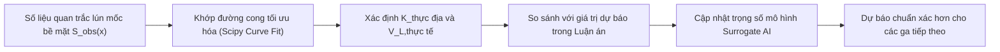

# CHƯƠNG 7: KẾT LUẬN, KIẾN NGHỊ VÀ QUY TRÌNH QUAN TRẮC HIỆN TRƯỜNG

---

## 7.1. CÁC KẾT LUẬN KHOA HỌC CHÍNH

Từ các kết quả nghiên cứu lý thuyết, mô hình hóa giải tích, đánh giá độ nhạy và tích hợp WebGIS – AI đối với đoạn ngầm S9–S12 Tuyến đường sắt đô thị số 3 Hà Nội, luận án rút ra các kết luận khoa học cốt lõi sau:

1. **Về đặc trưng địa tầng và yếu tố rủi ro địa kỹ thuật:**
   - Nghiên cứu đã xác lập cơ sở dữ liệu địa kỹ thuật có kiểm định nguồn minh bạch cho 3 mặt cắt đại diện: S9–S10 (Kim Mã - Cát Linh), S10–S11 (Cát Linh - Văn Miếu), và S11–S12 (Văn Miếu - Ga Hà Nội).
   - Phát hiện xung yếu địa chất lớn nhất là tại đoạn S11–S12 (hố khoan kiểm chứng BH12): đường hầm TBM chôn sâu $z_0 = 18.0\text{ m}$ nằm trọn vẹn trong một tầng bùn sét mềm hữu cơ dày tới $12.7\text{ m}$ có chỉ số SPT $N < 4$, mô-đun đàn hồi thấp kỷ lục ($E = 7.68\text{ MPa}$). Tầng đất yếu này làm mở rộng hệ số phễu lún lên $K = 0.60$ và khoảng cách điểm uốn $i = 10.8\text{ m}$, khiến phạm vi ảnh hưởng lún lan rộng sang hai bên tim tuyến.

2. **Về hình thái phễu lún và phân tích độ nhạy 21 kịch bản:**
   - Ở kịch bản kiểm soát đào tiêu chuẩn ($V_L = 1.0\%$), độ lún bề mặt cực đại của hầm đôi dao động từ $19.21\text{ mm}$ (S11–S12) đến $22.78\text{ mm}$ (S9–S10). Đoạn S9–S10 tuy đất tốt hơn nhưng do chôn nông hơn ($z_0=15.0\text{ m}$) nên có độ lún đỉnh và độ dốc cực đại lớn nhất ($\theta_{\max} = 1.341 \times 10^{-3}\text{ rad} \approx 1/745$).
   - Phân tích độ nhạy chứng minh rằng $V_L = 1.0\%$ là ngưỡng an toàn giới hạn. Nếu để xảy ra sự cố áp lực gương đào hoặc chậm phụt vữa làm $V_L$ tăng lên $1.5\% - 2.0\%$, độ lún cực đại sẽ vọt lên $34 - 45\text{ mm}$, độ dốc vượt quá $1/400$, đẩy hơn 70% số công trình lân cận vào cấp rủi ro hư hại vừa và nghiêm trọng (Cấp 3–4 theo Burland, 1995).

3. **Về đóng góp của công nghệ WebGIS và Surrogate AI:**
   - Hệ thống WebGIS tương tác mã nguồn mở (Leaflet.js) đã trực quan hóa phân vùng nguy cơ của 60 công trình móng nông đại diện, giúp các kỹ sư hiện trường nhận diện ngay các điểm nóng rủi ro dọc đường Kim Mã, Cát Linh và khu vực di tích Văn Miếu.
   - Mô hình mạng nơ-ron Surrogate AI (MLP 5-32-16-1) lập trình thuần NumPy đạt độ chính xác xuất sắc ($R^2 = 0.9991, MAE = 0.156\text{ mm}$), thời gian suy luận siêu tốc ($< 0.1\text{ ms}$), giải quyết triệt để bài toán dự báo độ lún không độ trễ phục vụ điều khiển khiên đào thời gian thực.

---

## 7.2. KIẾN NGHỊ KỸ THUẬT VẬN HÀNH KHIÊN ĐÀO EPB-TBM

Để đảm bảo tuyệt đối an toàn cho các công trình nhà dân và di tích lịch sử trong suốt quá trình khiên đào đi ngầm qua đoạn S9–S12, nhóm nghiên cứu đề xuất các kiến nghị kỹ thuật bắt buộc sau:

### 7.2.1. Kiểm soát chặt chẽ áp lực khoang đào và thể tích đất đào
1. **Duy trì áp lực cân bằng đất ($P_{\text{face}}$):**
   Người vận hành TBM phải cài đặt áp lực trong buồng đào luôn lớn hơn hoặc bằng áp lực đất tĩnh cộng áp lực thủy tĩnh ($P_{\text{face}} \ge K_0 \sigma'_v + u$). Tuyệt đối không để xảy ra tụt áp khoang đào khi khiên dừng lắp vỏ hầm hoặc khi thay dao cắt.
2. **Cân đong thể tích đất đào theo từng ring:**
   Trang bị hệ thống cân băng tải tự động (belt weigher) kết hợp quét laser thể tích đất trong thùng xe goòng. Nếu khối lượng đất đào thực tế của một ring ($1.5\text{ m}$) vượt quá 105% thể tích lý thuyết tiết diện đào ($A_t \times 1.5\text{ m} \approx 46.75\text{ m}^3$), phải lập tức dừng khiên, kiểm tra áp lực gương và tăng cường bơm bọt tạo huyền phù (foam/polymer).

### 7.2.2. Quy trình phụt vữa chèn lưng vỏ hầm (Backfill Grouting) áp lực cao
1. **Áp lực và loại vữa phụt:**
   Sử dụng vữa xi măng - cát hai thành phần (A+B) có thời gian đông kết nhanh ($10 - 20\text{ giây}$) để đất nền không kịp biến dạng sập vào khe hở đuôi khiên.
2. **Kiểm soát áp lực phụt tại đoạn bùn sét S11–S12:**
   Khi khiên đào đi qua tầng bùn sét mềm hữu cơ hố khoan BH12, áp lực phụt vữa qua đuôi khiên phải duy trì liên tục ở mức $2.5 - 3.5\text{ bar}$. Tổng thể tích vữa phụt mỗi ring phải đạt tối thiểu $130\% - 150\%$ thể tích hình học của khe hở đuôi khiên (tương đương $\ge 5.5 - 6.5\text{ m}^3/\text{ring}$).

### 7.2.3. Biện pháp bảo vệ đặc biệt đối với khu vực di tích Văn Miếu
Tại đoạn đi qua gần quần thể di tích Quốc Tử Giám (Km 10+200 đến Km 10+600):
- Bắt buộc kiểm soát thi công tối ưu để duy trì tỷ lệ tổn thất thể tích đất $V_L \le 0.5\%$.
- Thi công trước hàng cọc chắn bảo vệ (protective pile wall / jet grouting) ngăn cách giữa hành lang tuyến hầm và ranh giới di tích nếu cự ly mép hầm đến móng di tích nhỏ hơn $15\text{ m}$.

---

## 7.3. ĐỀ XUẤT QUY TRÌNH QUAN TRẮC ĐỊA KỸ THUẬT VÀ KẾ HOẠCH HÀNH ĐỘNG KHẨN CẤP (TARP)

### 7.3.1. Bố trí mạng lưới thiết bị quan trắc hiện trường
Nhóm tác giả kiến nghị bố trí hệ thống quan trắc địa kỹ thuật tự động dọc hành lang S9–S12 bao gồm:
1. **Các mặt cắt quan trắc lún ngang chính (Main Transverse Monitoring Sections):**
   Bố trí cách nhau $50 - 100\text{ m}$ dọc tuyến đường Kim Mã, Cát Linh, Quốc Tử Giám. Mỗi mặt cắt gồm 7 đến 11 mốc lún bề mặt (Surface Settlement Points) cắm trên mặt đường và vỉa hè theo phương ngang vuông góc với tim tuyến, trải rộng ra hai bên $\pm 30\text{ m}$.
2. **Hệ thống lăng kính quan trắc tự động (Robotic Total Station - RTS):**
   Gắn lăng kính phản xạ mini trên tường và cột của các ngôi nhà có nguy cơ cao (Cấp 2 trở lên) và các cổng đền cổ để đo độ lún và độ nghiêng liên tục 24/7 với tần suất 15–30 phút/lần.
3. **Giếng đo áp nước ngầm (Piezometers):**
   Lắp đặt các đầu đo áp lực nước lỗ rỗng dây rung (Vibrating Wire Piezometers) tại nóc và đáy hầm để theo dõi sự tiêu tán áp lực nước ngầm trong tầng bùn sét.

### 7.3.2. Ngưỡng phản ứng khẩn cấp (Trigger Action Response Plan - TARP)
Quy trình phản ứng khi phát hiện biến dạng lún được thiết lập theo cơ chế "Đèn giao thông" (Traffic Light System) trong Bảng 7.1:

 

**Bảng 7.1: Kế hoạch hành động ứng phó khẩn cấp theo các ngưỡng biến dạng (TARP)**

| Cấp cảnh báo | Ngưỡng độ lún mốc bề mặt ($S_v$) | Ngưỡng độ nghiêng công trình ($\theta$) | Tình trạng kỹ thuật | Hành động ứng phó bắt buộc |
|---|---|---|---|---|
| **XANH (Bình thường)** | $S_v < 10\text{ mm}$ | $\theta < 1/500$ | Vận hành bình thường, $V_L \le 0.75\%$. | Duy trì chế độ đào tiêu chuẩn, đo đạc quan trắc định kỳ 1 lần/ngày. |
| **VÀNG (Cảnh báo)** | $10\text{ mm} \le S_v < 20\text{ mm}$ | $1/500 \le \theta < 1/350$ | Tổn thất thể tích có xu hướng tăng ($V_L \approx 1.0\%$). | Tăng tần suất quan trắc lên 2 giờ/lần; tăng áp lực phụt vữa đuôi khiên thêm $0.5\text{ bar}$; kiểm tra chất lượng bọt xốp khoang đào. |
| **CAM (Nguy cơ cao)** | $20\text{ mm} \le S_v < 30\text{ mm}$ | $1/350 \le \theta < 1/200$ | $V_L$ tiệm cận $1.5\%$, xuất hiện vết nứt nhỏ trên tường nhà dân. | Họp khẩn cấp tổ kỹ thuật hiện trường; giảm tốc độ tiến của khiên TBM; chuẩn bị sẵn trạm bơm phụt vữa bù lún (compensation grouting). |
| **ĐỎ (Nguy cấp - Dừng máy)** | $S_v \ge 30\text{ mm}$ | $\theta \ge 1/200$ | Sự cố nghiêm trọng ($V_L > 1.5\%$), nguy cơ nứt dầm sàn công trình. | **DỪNG MÁY TBM NGAY LẬP TỨC**; duy trì áp lực giữ gương; tiến hành phụt vữa hóa chất hoặc vữa xi măng bù lún khẩn cấp dưới đáy móng công trình; sơ tán tạm thời người dân nếu cần. |

---

## 7.4. QUY TRÌNH KIỂM TOÁN DỮ LIỆU VÀ HIỆU CHỈNH NGƯỢC THAM SỐ (BACK-ANALYSIS)

Khi khiên đào TBM bắt đầu khoan từ ga S9, toàn bộ số liệu đo đạc thực tế của chuỗi mốc lún bề mặt sẽ được nạp vào quy trình hiệu chỉnh ngược tham số (Back-analysis Workflow) theo các bước:

> **Ghi chú Kiểm toán Khoa học (Audit Note 7.1):**
> - `==[AUDIT CẦN BỔ SUNG: Quy trình hiệu chỉnh ngược này là bước chuyển giao bắt buộc giữa bản thảo luận án lý thuyết và giai đoạn thi công thực tế tại công trường. Khi nhà thầu CP03 tiến hành đào hầm, nhóm nghiên cứu khuyến nghị áp dụng mã nguồn 'scripts/analytical_engine.py' để khớp hàm Gauss tự động, tìm ra hệ số K thực địa cho từng cung đoạn địa chất, từ đó đóng lại toàn bộ các cờ Audit Pending còn tồn đọng.]==`
