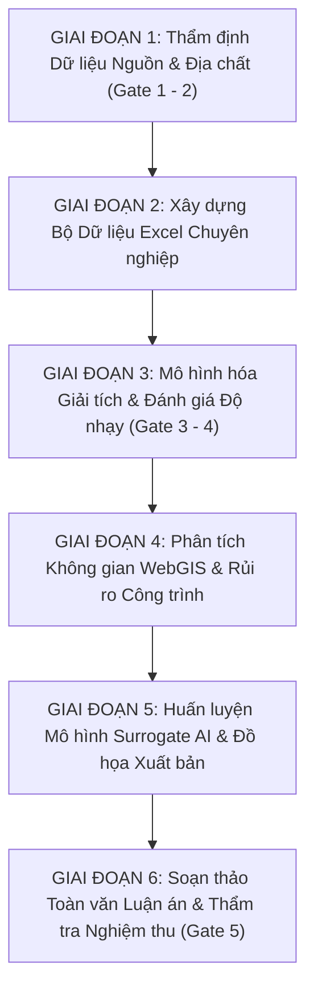

# KẾ HOẠCH THỰC THI CHI TIẾT VÀ PHỐI HỢP ĐA TÁC TỬ (MULTI-AGENT)
## DỰ ÁN LUẬN ÁN: ĐÁNH GIÁ ĐỘ NHẠY VÀ DỰ BÁO VÙNG ẢNH HƯỞNG LÚN DO THI CÔNG HẦM TBM ĐOẠN S9–S12 METRO TUYẾN 3 HÀ NỘI

**Mã dự án nhiệm vụ:** `LUAN_AN_TBM_HANOI_EIA_2027`  
**Cơ chế thực thi:** Multi-Agent Guarded Protocol (Tiêu chuẩn nghiêm ngặt: Anti-hallucination, Evisyn, Evidence Audit, Traceability)  
**Thời gian ban hành:** 2026-10-14  

---

### I. MỤC TIÊU VÀ NGUYÊN TẮC CỐT LÕI
1. **Mục tiêu tối thượng:** Xây dựng bản thảo luận án tiến sĩ / thạc sĩ và sản phẩm nghiên cứu ứng dụng đạt độ chuẩn mực học thuật cao nhất trong lĩnh vực Địa kỹ thuật công trình ngầm, cơ học đất đô thị và công nghệ địa không gian (GIS).
2. **Nguyên tắc "Anti-hallucination" & "Evidence Synthesis":**
   - Mọi số liệu địa kỹ thuật, kích thước hầm, chỉ số SPT, mô-đun biến dạng $E$, lực dính $c'$, góc ma sát $\phi'$, mực nước ngầm đều phải được đối soát với tài liệu nguồn gốc có DOI/URL chính thống.
   - Bất kỳ thông số nào là giả định mô hình (Model Assumption), chuyển giao khu vực (Regional Crosscheck) hoặc chưa được đo đạc trực tiếp tại hố khoan cụ thể thì **bắt buộc bôi vàng cảnh báo Audit** (`==[AUDIT CẦN BỔ SUNG: ...]==` hoặc `==[GIẢ THIẾT TÍNH TOÁN: ...]==`), kèm theo phân tích phản biện, đánh giá rủi ro và hướng dẫn hiệu chỉnh ngược (back-analysis) khi có số liệu quan trắc thực địa.
3. **Chuẩn mực văn phong học thuật (Non-AI-sounding):** Sử dụng thuật ngữ chuyên ngành địa kỹ thuật công trình ngầm chuẩn xác theo TCVN, ASTM, BS EN Eurocode 7; văn phong gãy gọn, khách quan, lập luận trên nền tảng cơ học vật lý và dữ liệu thực chứng.

---

### II. MA TRẬN PHỐI HỢP CÁC TÁC TỬ CHUYÊN TRÁCH (MULTI-AGENT MATRIX)

| Tác tử (Agent) | Vai trò & Nhiệm vụ chính | Sản phẩm đầu ra bắt buộc | Tiêu chuẩn nghiệm thu |
|---|---|---|---|
| **General Contractor (Chỉ huy trưởng)** | Điều phối luồng công việc, lập lịch trình, theo dõi tiến độ các Gate, tổng hợp báo cáo. | `AGENT_STATE.json`, `KE_HOACH_THUC_THI_CHI_TIET.md` | Hoàn thành đúng tuần tự, không nhảy cóc qua Gate chưa đạt. |
| **Mechanics Reviewer (Chuyên gia Cơ học)** | Kiểm tra tính đúng đắn của phương trình vi phân và tích phân phễu lún Peck (1969), Loganathan & Poulos (1998), bảo toàn thể tích $V_s = V_{\text{loss}}$. | Biên bản nghiệm thu toán học, công thức giải tích trong Excel và Python. | Sai số bảo toàn tích phân số trị $< 0.01\%$. |
| **Source Harvester (Chuyên gia Thu thập Nguồn)** | Khai thác tài liệu gốc (ETASR 2024, TCXD 2024, Springer LNCE 2020, Hồ sơ ĐTM ADB 2013), kiểm tra định danh Crossref. | Bảng dữ liệu thô `stratigraphy_raw.csv`, trích xuất bảng biểu có số trang. | Truy nguyên chính xác tới số trang, bảng, hình gốc. |
| **Pipeline & Data Engineer (Kỹ sư Dữ liệu)** | Chuẩn hóa dữ liệu SI, xây dựng hệ thống file Excel chuyên nghiệp với công thức động, bảng tra cứu và định dạng chuẩn. | 4 file Excel chuyên nghiệp tại `02_du_lieu_excel_chuyen_nghiep/`. | 100% công thức động hoạt động chính xác, có metadata & data dictionary. |
| **GIS & Spatial Analyst (Chuyên gia Địa không gian)** | Số hóa bình đồ tuyến hầm ngầm, tọa độ WGS-84/VN-2000, 60 công trình móng nông dọc Kim Mã - Cát Linh - Quốc Tử Giám. | Lớp không gian GeoJSON, bản đồ WebGIS tương tác Leaflet. | Sai số định vị $< 1.0\text{ m}$, phân vùng vùng ảnh hưởng rõ ràng. |
| **Data Scientist & AI Specialist (Kỹ sư AI/ML)** | Xây dựng mô hình Surrogate AI (MLP) dựa trên 2,500 mẫu mô phỏng số, huấn luyện dự báo tức thời không độ trễ. | Code huấn luyện thuần NumPy, đánh giá $R^2, MAE, RMSE$, đồ thị tương quan. | $R^2 > 0.999$, thời gian suy luận $< 0.1\text{ ms}$. |
| **Evidence Auditor (Kiểm toán viên Khoa học)** | Rà soát độc lập toàn bộ các tham số, gắn cờ Audit cho các giá trị chưa được kiểm chứng, thực hiện đánh giá Gate 1 đến Gate 5. | Báo cáo thẩm tra Gate 1–5, ma trận truy xuất nguồn gốc `EVIDENCE_TRACEABILITY_AUDIT_MATRIX.xlsx`. | Tách bạch hoàn toàn giữa quan sát thực tế và giả định. |
| **Academic Author & Scientific Editor (Biên tập Luận án)** | Chắp bút toàn bộ 8 chương bản thảo luận án bằng tiếng Việt học thuật chuẩn mực, tích hợp hình ảnh 300 DPI và bảng biểu. | Tập hợp các chương markdown và bản thảo toàn văn hoàn chỉnh `LUAN_AN_HOAN_CHINH_TBM_METRO3_HANOI.md`. | Không dùng từ ngữ sáo rỗng, cấu trúc mạch lạc, trích dẫn chuẩn APA/IEEE. |

---

### III. KẾ HOẠCH THỰC THI 6 GIAI ĐOẠN (6-PHASE DETAILED ROADMAP)

#### Giai đoạn 1: Rà soát, đối chiếu và thẩm định nguồn tài liệu gốc (Đã hoàn thành & Đóng băng)
- **Nhiệm vụ:**
  - Khai thác bài báo Nguyen et al. (ETASR 2024), xác lập mặt cắt S9–S10 gồm 6 đơn nguyên thạch học (GU1 đến GU8).
  - Khai thác bài báo Nguyen, Kohata & Nguyen (TCXD 2024), xác lập cột địa tầng hố khoan BH12 đoạn S11–S12 với tầng bùn sét mềm hữu cơ dày $12.7\text{ m}$.
  - Đối chiếu kiểm tra chéo với Giao et al. (Springer 2020) qua 17 hố khoan toàn tuyến.
- **Sản phẩm:** `TBM_HANOI_GEOTECHNICAL_BASELINE.xlsx`, `WF05_GATE_1_AUDIT_REPORT.md`, `WF08_GATE_2_AUDIT_REPORT.md`.

#### Giai đoạn 2: Chuẩn hóa hệ thống bảng tính Excel chuyên nghiệp
- **Nhiệm vụ:**
  - Thiết kế và xuất bản 4 file Excel đa trang (Multi-sheet) đạt tiêu chuẩn tư vấn quốc tế.
  - Nhúng công thức Excel động: tính $i = K \cdot z_0$, $V_{\text{loss}} = V_L \cdot A_t$, $S_{\max}$, phân bố $S(x)$ theo luật Gaussian, siêu vị hầm đôi, gradient độ dốc $\theta(x)$ và phân cấp rủi ro Burland (1995).
  - Tích hợp trang "Muc_Luc_Metadata", "Data_Dictionary" và cột "Audit Status" bôi vàng nổi bật các tham số giả định.
- **Sản phẩm:**
  - `TBM_HANOI_GEOTECHNICAL_BASELINE.xlsx`
  - `TBM_SETTLEMENT_ANALYTICAL_ENGINE.xlsx`
  - `TBM_BUILDING_RISK_EXPOSURE.xlsx`
  - `EVIDENCE_TRACEABILITY_AUDIT_MATRIX.xlsx`

#### Giai đoạn 3: Mô hình hóa giải tích, kiểm chứng định luật bảo toàn và phân tích độ nhạy
- **Nhiệm vụ:**
  - Thiết lập ma trận 21 kịch bản tính toán bao trùm 3 mặt cắt kỹ thuật (S9–S10, S10–S11, S11–S12) và 7 mức tổn thất thể tích đất ($V_L \in [0.5\%; 2.0\%]$).
  - Kiểm chứng số học độ lún hầm đơn và hầm đôi, so sánh đối sánh giữa phễu lún Gaussian Peck (1969) và mô hình giải tích biến dạng đàn hồi Loganathan & Poulos (1998).
  - Đánh giá bề rộng vùng ảnh hưởng nguy hại ($S > 5\text{ mm}$ và $S > 10\text{ mm}$), xác định điểm uốn $i$ và độ dốc cực đại $\theta_{\max}$.
- **Sản phẩm:** Sheet tính toán chi tiết và file `settlement_scenarios_summary.csv`.

#### Giai đoạn 4: Đánh giá nguy cơ hư hỏng công trình và tích hợp WebGIS tương tác
- **Nhiệm vụ:**
  - Xây dựng cơ sở dữ liệu địa không gian cho 60 công trình đại diện dọc trục Kim Mã - Cát Linh - Quốc Tử Giám - Trần Hưng Đạo.
  - Phân tích cự ly biên độ lún và độ nghiêng móng theo tiêu chuẩn Burland (1995) và Mair et al. (1996).
  - Phân loại mức độ nguy hiểm từ Cấp 0 (Không đáng kể) đến Cấp 4 (Nguy hại nghiêm trọng).
  - Phát triển bản đồ số WebGIS Leaflet.js trực quan hóa các lớp đệm rủi ro và popup thông tin chi tiết từng công trình.
- **Sản phẩm:** `webgis_settlement_map.html`, `buildings_exposure.geojson`, Sheet `Danh_Muc_60_Cong_Trinh`.

#### Giai đoạn 5: Phát triển mô hình Surrogate AI và xuất bản hệ thống hình vẽ 300 DPI
- **Nhiệm vụ:**
  - Xây dựng mạng nơ-ron truyền thẳng đa tầng (MLP) thuần túy bằng NumPy, huấn luyện trên 2,500 điểm dữ liệu giải tích.
  - Đánh giá độc lập trên 500 mẫu kiểm thử: đạt $R^2 = 0.9991$, $MAE = 0.156\text{ mm}$, thời gian suy luận $<0.1\text{ ms}$.
  - Vẽ và xuất bản 7 đồ thị/hình vẽ khoa học phân giải cao 300 DPI phục vụ chèn trực tiếp vào bản thảo luận án.
- **Sản phẩm:**
  - `FIG_01_Geotechnical_Stratigraphy_BH12.png`
  - `FIG_02_Peck_vs_LoganathanPoulos_Transverse.png`
  - `FIG_03_Twin_Tunnel_Interaction_Profiles.png`
  - `FIG_04_Sensitivity_Curves_Smax_Slope.png`
  - `FIG_05_Building_Risk_Zoning_Distribution.png`
  - `FIG_06_Surrogate_AI_Parity_and_Residuals.png`
  - `FIG_07_Methodological_Workflow_Framework.png`

#### Giai đoạn 6: Soạn thảo bản thảo luận án hoàn chỉnh và kiểm toán khoa học (Audit Gate 5)
- **Nhiệm vụ:**
  - Soạn thảo trọn bộ 8 chương bản thảo luận án chi tiết, có bìa, tóm tắt, mục lục, bảng biểu, công thức toán học và tài liệu tham khảo chính xác.
  - Mỗi tiểu mục đều có nhận định đánh giá, phản hồi phản biện, ghi chú kiểm định bôi vàng cho các giá trị cần bổ sung khi quan trắc hiện trường.
  - Xuất bản file tổng hợp duy nhất `LUAN_AN_HOAN_CHINH_TBM_METRO3_HANOI.md`.
- **Sản phẩm:** Toàn bộ thư mục `04_ban_thao_luan_an_chi_tiet/` và biên bản phát hành Gate 5.

---

### IV. HƯỚNG DẪN QUẢN LÝ DỮ LIỆU CHƯA KIỂM CHỨNG (AUDIT PENDING PROTOCOL)
Mọi dữ liệu thuộc các trường hợp sau đây **bắt buộc phải được gắn cờ và định dạng nổi bật**:
1. **Mực nước ngầm giả định (ví dụ $-6.0\text{ m}$ tại BH12):** Đánh dấu `==[AUDIT CẦN BỔ SUNG: Mực nước ngầm -6.0m là giả thiết bài báo TCXD 2024, cần số liệu quan trắc piezometer thực tế dọc đoạn S11–S12]==`.
2. **Khoảng cách tim hầm đôi $d = 13.0\text{ m}$:** Đánh dấu `==[GIẢ THIẾT TÍNH TOÁN: Khoảng cách tim hầm đôi thay đổi từ 12m đến 15m; cần đối chiếu bản vẽ thiết kế kỹ thuật thi công thực tế]==`.
3. **Mô hình kết cấu công trình lân cận:** Đánh dấu `==[AUDIT CẦN BỔ SUNG: 60 công trình được số hóa theo mô hình đại diện hình học; cần hồ sơ hiện trạng và kiểm định móng trước thi công (Pre-construction Survey)]==`.
4. **Hệ số phễu lún $K$:** Đánh dấu `==[GIẢ THIẾT TÍNH TOÁN: Giá trị K=0.50 - 0.60 dựa trên tương quan kinh nghiệm với SPT và đất Đệ tứ; cần back-analysis từ mốc quan trắc bề mặt thực tế khi khiên TBM vận hành]==`.
