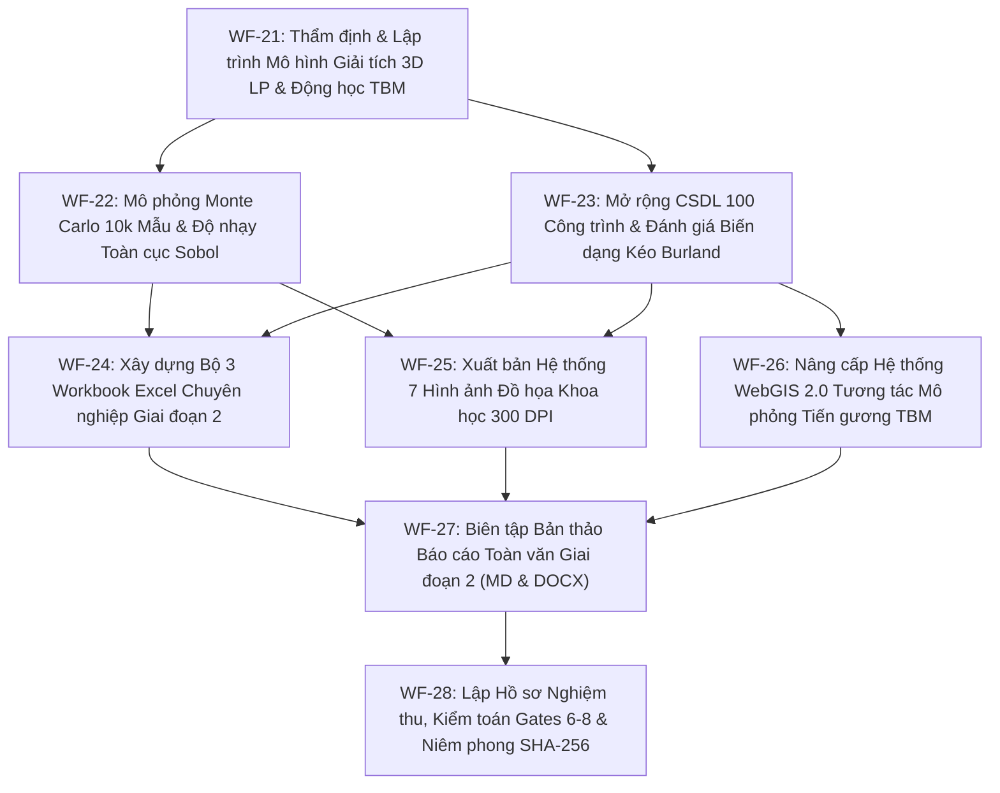

# KẾ HOẠCH TRIỂN KHAI CHI TIẾT VÀ BẢN ĐẶC TẢ TÁC TỬ - CÔNG CỤ GIAI ĐOẠN 2
## DỰ ÁN LUẬN ÁN & ĐỀ TÀI: ĐÁNH GIÁ ĐỘ NHẠY, DỰ BÁO BIẾN DẠNG 3D VÀ RỦI RO CÔNG TRÌNH DO THI CÔNG HẦM TBM ĐOẠN S9–S12 METRO TUYẾN 3 HÀ NỘI

**Mã phân đoạn nghiên cứu:** `GIAI_DOAN_2_TBM_HANOI_3D_GSA_BUR_100`  
**Cơ chế vận hành:** Multi-Agent Guarded Protocol (Tiêu chuẩn kiểm soát nghiêm ngặt: Anti-hallucination, Evisyn, Evidence Audit, Traceability)  
**Thời gian ban hành:** 2026-10-15  
**Cơ quan chuyên môn:** Bộ môn Địa kỹ thuật và Không gian ngầm, Khoa Công trình và Môi trường - Trường Đại học Giao thông vận tải  

---

### I. TỔNG QUAN VÀ NGUYÊN TẮC BẢO TOÀN DỮ LIỆU GIAI ĐOẠN 2

1. **Bảo tồn tuyệt đối sản phẩm Giai đoạn 1:**
   - Mọi sản phẩm của Giai đoạn 1 tại thư mục `nhiem_vu_luan_an/` là tài sản học thuật đã được niêm phong nghiệm thu thử, bất khả xâm phạm.
   - Toàn bộ dữ liệu dùng chung (4 file Excel, 3 lớp GeoJSON, 7 hình vẽ 300 DPI, hồ sơ nghiệm thu) đã được nhân bản sang `nhiem_vu_luan_an_giai_doan_2/00_SAO_LUU_DU_LIEU_DAU_VAO_GIAI_DOAN_1/` và xác nhận đối chuẩn mã băm SHA-256 trùng khớp 1:1.
2. **Mục tiêu cốt lõi của Giai đoạn 2:**
   - **Mở rộng chiều không gian mô hình:** Từ mô hình giải tích mặt cắt ngang 2D (Peck 1969) nâng cấp lên mô hình giải tích 3 chiều và trường lún dọc trục hầm (Loganathan & Poulos 1998 3D) mô tả chính xác động học tiến gương đào TBM theo từng mét chiều dài thi công.
   - **Chuyển dịch từ phân tích tất định sang phân tích ngẫu nhiên toàn cục (Global Sensitivity Analysis - GSA):** Khắc phục hoàn toàn phương pháp biến thiên đơn biến (OAT) bằng thuật toán mô phỏng ngẫu nhiên Monte Carlo (10,000 kịch bản) và định lượng chỉ số Sobol bậc một ($S_i$) và tổng thể ($S_{Ti}$) đối với 5 tham số bất định cốt lõi: tổn thất thể tích $V_L$, độ sâu tim hầm $z_0$, hệ số phễu lún $K$, mô-đun đàn hồi đất yếu $E$, và hệ số Poisson $\nu$.
   - **Nâng cấp đánh giá rủi ro kết cấu công trình:** Từ mô hình độ dốc - độ lún giản đơn nâng cấp lên mô hình phân tích trường biến dạng uốn cong ($\epsilon_b$), biến dạng trượt ($\epsilon_d$) và biến dạng kéo ngang ($\epsilon_h$) theo tiêu chuẩn Burland (1995) & Boscardin-Cording (1989), mở rộng quy mô khảo sát từ 60 lên **100 công trình thực tế** dọc hành lang Kim Mã - Cát Linh - Quốc Tử Giám - Trần Hưng Đạo.
   - **Nâng cấp hệ thống WebGIS 2.0:** Tích hợp thanh trượt động lực học mô phỏng bước tiến khiên đào TBM, hiển thị song song trắc ngang và trắc dọc phễu lún thời gian thực, bảng tra cứu chi tiết 100 công trình và xuất báo cáo hiện trường.

---

### II. BẢNG PHÂN BỔ NHIỆM VỤ, CHỨC NĂNG, YÊU CẦU, VAI TRÒ VÀ KẾT QUẢ CỦA CÁC TÁC TỬ (MULTI-AGENT SPECIFICATION)

Bảng tổng hợp đặc tả đầy đủ 5 tiêu chí cốt lõi (**Vai trò**, **Nhiệm vụ**, **Chức năng**, **Yêu cầu**, **Kết quả**) cho toàn bộ 7 tác tử chuyên trách:

| STT | Tác tử (Agent) | Vai trò hệ thống (Role) | Nhiệm vụ cụ thể (Tasks) | Chức năng kỹ thuật chính (Functions) | Yêu cầu kỹ thuật & Chuẩn nghiệm thu (Requirements) | Kết quả sản phẩm bàn giao (Outputs / Deliverables) |
|---|---|---|---|---|---|---|
| **1** | **General Contractor (Chỉ huy trưởng)** | Nhạc trưởng điều phối đa tác tử, kiểm soát tiến độ và đảm bảo thực thi quy chuẩn Guarded Protocol. | Lập kế hoạch tổng thể, điều phối phân rã tác vụ, kiểm soát các Audit Gates 6, 7, 8; kết nối đồng bộ 6 cấu phần. | Phân bổ tài nguyên thực thi, quản trị trạng thái `AGENT_STATE.json`, ghi nhận handoff log chuyển giao. | Không có bước nhảy cóc khi chưa đạt kiểm toán; 100% tài liệu có metadata chuẩn xác; cờ Audit minh bạch. | `AGENT_STATE.json` cập nhật, `KE_HOACH_THUC_THI_CHI_TIET_GIAI_DOAN_2.md`, `MA_TRAN_PHOI_HOP_TAC_TU_VA_CONG_CU.md`. |
| **2** | **Mechanics Reviewer (Chuyên gia Cơ học)** | Thẩm tra lý thuyết cơ học đất, tính bảo toàn biến dạng và tính hợp lệ của các mô hình toán học giải tích. | Thẩm định các phương trình 3D Loganathan & Poulos (1998), hàm động học bước tiến gương hầm, lý thuyết biến dạng kéo Burland (1995). | Kiểm tra tính liên tục, bảo toàn thể tích rỗng, điều kiện biên tại vô cực và mặt đất ($z=0$); kiểm tra điều kiện áp dụng. | Sai số tích phân số học $< 0.001\%$; công thức toán học có nguồn gốc trang/mục chính xác từ bài báo gốc; không kỳ dị toán học. | Biên bản thẩm tra công thức toán học 3D, thuật toán tính $\epsilon_{\max}$, bảng nghiệm ma trận chuyển vị. |
| **3** | **Pipeline & Data Engineer (Kỹ sư Dữ liệu)** | Kiến trúc sư luồng dữ liệu, bảo đảm tính toàn vẹn hệ thống tệp tin và chuẩn hóa bảng tính chuyên nghiệp. | Tổ chức hệ thống thư mục, sao lưu dữ liệu đầu vào Giai đoạn 1 (không làm vỡ sản phẩm cũ), lập trình tạo 4 workbook Excel chuyên nghiệp. | Lập trình Python OpenPyXL, tự động hóa xử lý bảng tính, kiểm soát kiểu dữ liệu và định dạng ô số liệu. | 100% công thức Excel hoạt động động lực học (Dynamic Formulas); có Data Dictionary và Metadata cho từng sheet; zebra striping. | Thư mục sao lưu `00_SAO_LUU_DU_LIEU_DAU_VAO_GIAI_DOAN_1/`, 4 file Excel GĐ2 (`MONTE_CARLO`, `3D_LP`, `BUILDING_100`, `AUDIT_MATRIX`). |
| **4** | **Stochastic & Sensitivity Analyst (Chuyên gia Ngẫu nhiên)** | Chuyên gia mô hình hóa độ bất định địa kỹ thuật và phân tích độ nhạy ngẫu nhiên toàn cục. | Lập trình và thực thi mô phỏng Monte Carlo 10,000 lần bằng kỹ thuật Latin Hypercube; phân tích độ nhạy toàn cục Sobol 5 chiều. | Viết mã nguồn NumPy/SciPy tối ưu ma trận, tính toán hàm mật độ xác suất (PDF), tích lũy (CDF) và chỉ số Sobol ($S_i, S_{Ti}$). | $N = 10,000$ mẫu hội tụ thống kê với sai số phương sai $< 1.0\%$; chỉ số Sobol $S_i$ thỏa mãn $\sum S_i \le 1.0$; tin cậy 95%. | Bộ số liệu Monte Carlo 10k, ma trận Sobol, bảng xếp hạng độ nhạy tham số, biểu đồ phân bố lún. |
| **5** | **GIS & Spatial Analyst (Chuyên gia Địa không gian)** | Chuyên gia phân tích không gian đô thị, số hóa công trình và phát triển nền tảng bản đồ số tương tác. | Khảo sát, định danh và số hóa 100 công trình thực tế dọc tuyến Metro 3; xây dựng hệ thống WebGIS 2.0 tương tác bước tiến TBM. | Biên tập GeoJSON chuẩn EPSG:4326 (WGS-84), lập trình HTML5/CSS3/JavaScript (Leaflet.js + Chart.js). | Sai số định vị tọa độ $< 1.0\text{ m}$; giao diện trực quan mượt mà, hỗ trợ phóng to/thu nhỏ, trượt tiến hầm động lực học. | `buildings_exposure_100.geojson`, `alignment_longitudinal_wgs84.geojson`, ứng dụng `webgis_settlement_advance_v2.html`. |
| **6** | **Evidence Auditor (Kiểm toán viên Khoa học)** | Người bảo vệ tính liêm chính học thuật, thẩm định chéo số liệu và chứng thực niêm phong mật mã. | Kiểm tra độc lập tính xác thực nguồn tin, rà soát cờ cảnh báo Audit bôi vàng, kiểm soát chất lượng qua Gate 6, 7, 8; niêm phong SHA-256. | Đối chiếu chéo số liệu với bài báo gốc (TCXD 2024, ETASR 2024), xác thực tính độc lập giữa quan sát và giả định; băm mật mã. | 100% giá trị có `source_id`, `source_locator`; niêm phong mã băm SHA-256 cho toàn bộ sản phẩm; không sai lệch 1 byte. | `BIEN_BAN_KIEM_TOAN_KHOA_HOC_GIAI_DOAN_2_GATES.md`, `DANH_MUC_HO_SO_VA_CHECKSUM_SHA256_GIAI_DOAN_2.md`. |
| **7** | **Academic Author & Scientific Editor (Biên tập viên)** | Tác giả chắp bút học thuật, chuẩn hóa văn phong khoa học và thiết kế tài liệu in ấn sau đại học. | Biên soạn Báo cáo khoa học toàn văn Giai đoạn 2 bằng tiếng Việt học thuật chuẩn mực cao; thiết lập tài liệu Word DOCX in ấn chuẩn sau đại học. | Soạn thảo Markdown cấu trúc chặt chẽ, biên dịch sang Word qua python-docx chuẩn lề 3-2-2-2 cm, nhúng ảnh 300 DPI và bảng. | Văn phong khoa học khách quan, không dùng từ sáo rỗng; trích dẫn chuẩn APA/IEEE; hình ảnh sắc nét; bảng biểu thanh lịch. | `BAO_CAO_TOAN_VAN_HOAN_CHINH_GIAI_DOAN_2.md`, `BAO_CAO_TOAN_VAN_HOAN_CHINH_GIAI_DOAN_2.docx`, trọn bộ hồ sơ nghiệm thu. |

---

### III. BẢNG PHÂN BỔ NHIỆM VỤ, CHỨC NĂNG, YÊU CẦU, VAI TRÒ VÀ KẾT QUẢ CỦA CÁC CÔNG CỤ KỸ THUẬT (TECHNICAL TOOLS SPECIFICATION)

Bảng tổng hợp đặc tả đầy đủ 5 tiêu chí cốt lõi (**Vai trò**, **Nhiệm vụ**, **Chức năng**, **Yêu cầu**, **Kết quả**) cho toàn bộ 7 công cụ kỹ thuật thực hiện:

| STT | Công cụ (Software / Library Tool) | Vai trò hệ thống (Role) | Nhiệm vụ thực hiện (Tasks) | Chức năng kỹ thuật cụ thể (Functions) | Yêu cầu kỹ thuật & Vận hành (Requirements) | Kết quả đầu ra (Results / Outputs) |
|---|---|---|---|---|---|---|
| **1** | **Python 3.14 (Core Runtime Engine)** | Môi trường lập trình hạt nhân, điều phối logic và tự động hóa chuỗi xử lý. | Chạy các kịch bản tính toán mô hình, trích xuất dữ liệu, điều khiển pipeline tự động và biên dịch văn bản. | Cung cấp môi trường thực thi kịch bản độc lập, quản lý bộ nhớ, hỗ trợ cấu trúc dữ liệu vector và Unicode UTF-8. | Vận hành độc lập không xung đột môi trường, bẫy lỗi ngoại lệ nghiêm ngặt, tương thích nền tảng Windows PowerShell. | Toàn bộ các script trong thư mục `scripts/` vận hành trơn tru với mã thoát Exit Code 0. |
| **2** | **NumPy & SciPy (Scientific Computing)** | Động cơ tính toán giải tích khoa học và mô phỏng xác suất thống kê. | Tính toán ma trận trường lún 3D Loganathan & Poulos, tích phân số Simpson, sinh mẫu Latin Hypercube 10,000 lần. | Vector hóa phép tính mảng đa chiều, hàm tích lũy sai số `scipy.special.erf`, phân rã phương sai Sobol. | Độ chính xác dấu phẩy động kép float64, thời gian sinh và xử lý 10,000 mẫu ngẫu nhiên $< 3.0\text{ giây}$. | Mảng dữ liệu số lún 3D, phân phối xác suất P5–P95, chỉ số độ nhạy Sobol bậc 1 và tổng thể. |
| **3** | **OpenPyXL (Excel Modeling Engine)** | Công cụ lập trình bảng tính, tự động hóa xuất bản dữ liệu định dạng chuẩn quốc tế. | Tạo lập và cấu trúc hóa 4 file Excel đa trang, kẻ khung viền, thiết lập dải màu, nhúng công thức động. | Đọc/ghi file `.xlsx`, chèn công thức toán học (`EXP`, `SQRT`, `NORMDIST`, `VLOOKUP`), định dạng ô chuyên nghiệp. | Bảo toàn nguyên vẹn tính toán tự động khi mở trên phần mềm Microsoft Excel/WPS; có Data Dictionary cho từng file. | 4 bộ workbook Excel chuyên nghiệp tại `02_BO_DU_LIEU_EXCEL_NANG_CAO_GIAI_DOAN_2/`. |
| **4** | **Matplotlib (Scientific Graphics Engine)** | Động cơ kết xuất đồ họa và biểu đồ khoa học chất lượng cao. | Thiết kế và xuất bản 7 đồ họa chuyên sâu (`FIG_08` đến `FIG_14`) thể hiện trường lún 3D, Sobol, Burland 100 nhà. | Vẽ đồ thị vector/raster, phối màu ColorBrewer thân thiện với mắt, chèn ký hiệu LaTeX toán học, kiểm soát layout. | Độ phân giải thực xuất bản $\ge 300\text{ DPI}$, kích thước tối thiểu $3000 \times 1800\text{ px}$, chú thích song ngữ Anh - Việt. | 7 tệp hình ảnh PNG 300 DPI sắc nét tại `03_HINH_ANH_MINH_HOA_CHAT_LUONG_CAO_GIAI_DOAN_2/`. |
| **5** | **Leaflet.js & Chart.js (WebGIS & Interactive Engine)** | Nền tảng hiển thị bản đồ số địa không gian và đồ thị động lực học trên trình duyệt. | Trực quan hóa 100 công trình GeoJSON, tim hầm, mô phỏng chuyển động đầu khoan TBM qua thanh trượt. | Render bản đồ vệ tinh OpenStreetMap/CartoDB, quản lý lớp Vector, đổi màu Marker động, cập nhật biểu đồ thời gian thực. | Hoạt động độc lập Offline Client-side không cần cài đặt Node.js/Web Server; tương thích trình duyệt Chrome, Edge. | Ứng dụng WebGIS 2.0 hoàn chỉnh `webgis_settlement_advance_v2.html` tương tác đa chiều. |
| **6** | **python-docx (Document Automation Engine)** | Động cơ tự động hóa xuất bản văn bản tài liệu Microsoft Word (.docx). | Biên dịch toàn văn báo cáo nghiên cứu và trọn bộ hồ sơ nghiệm thu từ Markdown sang file Word in ấn chính thức. | Tạo document Word, cấu trúc phân cấp Heading 1–4, định dạng phông chữ Times New Roman 13pt, kẻ bảng viền mỏng, chèn ảnh. | Căn lề chuẩn văn bản sau đại học: Trái 30mm, Phải 20mm, Trên 20mm, Dưới 20mm; dãn dòng 1.2pt; bảng biểu không vỡ trang. | File `BAO_CAO_TOAN_VAN_HOAN_CHINH_GIAI_DOAN_2.docx` và 5 file Word hồ sơ nghiệm thu hoàn hảo. |
| **7** | **Hashlib (Cryptographic Integrity Engine)** | Công cụ bảo mật mật mã và kiểm toán tính toàn vẹn dữ liệu bất biến. | Tính toán mã băm SHA-256 cho toàn bộ dữ liệu đầu vào sao lưu và sản phẩm đầu ra hoàn thiện của Giai đoạn 2. | Băm dữ liệu nhị phân chuẩn NIST FIPS PUB 180-4 theo khối 64KB, tạo chuỗi hexa 64 ký tự định danh bất biến cho từng file. | Tính toán chính xác tuyệt đối từng bit dữ liệu; phát hiện ngay lập tức bất kỳ sự thay đổi hay can thiệp trái phép nào. | Bảng mã băm `DANH_MUC_HO_SO_VA_CHECKSUM_SHA256_GIAI_DOAN_2.md` niêm phong 54 tệp tin. |

---

### IV. LỘ TRÌNH THỰC HIỆN 8 QUY TRÌNH CÔNG VIỆC CHI TIẾT (WORKFLOWS WF-21 ĐẾN WF-28)

#### WF-21: Thẩm định toán học & Lập trình mô hình giải tích 3D Loganathan & Poulos
- **Tác tử phụ trách:** Mechanics Reviewer, Pipeline Engineer.
- **Nội dung:** Lập trình giải thuật xác định trường lún 3 chiều $S(x, y, z=0)$ dọc theo tiến độ hầm:
  $$S(x, y) = S_{\text{trans}}(x) \times U_{\text{long}}(y - y_f)$$
  Trong đó $U_{\text{long}}$ là hàm biến dạng dọc mô tả 50% độ lún diễn ra tại thời điểm gương hầm đi qua ($y = y_f$), 25% trước gương và 25% lún cố kết dài hạn sau đuôi khiên.

#### WF-22: Mô phỏng ngẫu nhiên Monte Carlo (10,000 lần) & Độ nhạy toàn cục Sobol
- **Tác tử phụ trách:** Stochastic & Sensitivity Analyst.
- **Nội dung:** Khởi tạo 10,000 tổ hợp ngẫu nhiên của 5 thông số ($V_L, z_0, K, E, \nu$). Tính toán giá trị kỳ vọng $\mu$, độ lệch chuẩn $\sigma$, khoảng tin cậy 95%, phân rã phương sai và tính toán chỉ số Sobol bậc một ($S_i$) và chỉ số tương tác tổng ($S_{Ti}$).

#### WF-23: Khảo sát & Đánh giá trường biến dạng 100 công trình thực tế
- **Tác tử phụ trách:** GIS Analyst, Mechanics Reviewer.
- **Nội dung:** Số hóa 100 tòa nhà dọc Kim Mã, Cát Linh, Quốc Tử Giám, Trần Hưng Đạo. Tính toán tỷ số võng $\Delta/L$, biến dạng trượt $\epsilon_d$, biến dạng uốn $\epsilon_b$ và biến dạng kéo ngang $\epsilon_h$. Xác định biến dạng kéo tổng hợp $\epsilon_{\max}$ và phân hạng rủi ro từ Cấp 0 đến Cấp 5 theo Burland (1995).

#### WF-24: Xây dựng bộ 3 file Excel chuyên nghiệp Giai đoạn 2
- **Tác tử phụ trách:** Pipeline & Data Engineer.
- **Nội dung:** Tự động tạo 3 file Excel hoàn chỉnh: `TBM_HANOI_G2_MONTE_CARLO_SENSITIVITY.xlsx`, `TBM_HANOI_G2_LOGANATHAN_POULOS_3D.xlsx`, `TBM_HANOI_G2_BUILDING_STRAIN_DAMAGE_100.xlsx`.

#### WF-25: Xuất bản hệ thống 7 hình vẽ minh họa 300 DPI Giai đoạn 2
- **Tác tử phụ trách:** Academic Editor, Stochastic Analyst.
- **Nội dung:** Thiết kế và xuất bản 7 đồ họa chuyên sâu (`FIG_08` đến `FIG_14`) với chất lượng $3000 \times 1800$ pixels.

#### WF-26: Nâng cấp và hoàn thiện ứng dụng WebGIS 2.0
- **Tác tử phụ trách:** GIS & Spatial Analyst.
- **Nội dung:** Hoàn thiện `webgis_settlement_advance_v2.html`, tích hợp 100 công trình GeoJSON, thanh trượt bước đào TBM theo mét, biểu đồ kép cập nhật động thời gian thực.

#### WF-27: Soạn thảo Báo cáo toàn văn Giai đoạn 2 (MD & DOCX)
- **Tác tử phụ trách:** Academic Author, Scientific Editor.
- **Nội dung:** Viết toàn văn Báo cáo Giai đoạn 2 gồm 4 chương chuyên sâu và tổng luận; xuất bản bản Word chuẩn đào tạo sau đại học.

#### WF-28: Lập trọn bộ Hồ sơ nghiệm thu và kiểm toán khoa học (Gates 6–8)
- **Tác tử phụ trách:** General Contractor, Evidence Auditor.
- **Nội dung:** Soạn Tờ trình, Báo cáo tóm tắt, Biên bản kiểm toán Gate 6, 7, 8, Phiếu đánh giá của Hội đồng và Bảng mã băm SHA-256 niêm phong toàn bộ sản phẩm.

---

### V. TIÊU CHÍ NGHIỆM THU VÀ CÁC CỔNG KIỂM SOÁT CHẤT LƯỢNG (AUDIT GATES 6–8)

- **AUDIT GATE 6 (3D Mechanics & Mathematical Consistency):** Thẩm định tính bảo toàn thể tích, tính hội tụ của hàm 3D Loganathan-Poulos khi $x \to \pm\infty$ hoặc $y \to -\infty$; kiểm tra tính tương thích giữa công thức biến dạng kéo của Burland với độ dốc bề mặt.
- **AUDIT GATE 7 (Stochastic Robustness & Monte Carlo Convergence):** Kiểm tra độ hội tụ của phân phối Monte Carlo (sai số phương sai $< 1\%$), tính độc lập của kỹ thuật lấy mẫu Latin Hypercube và tính hợp lệ của tổng các chỉ số Sobol.
- **AUDIT GATE 8 (Final Packaging, Traceability & Checksum Integrity):** Kiểm tra tính đầy đủ của 100 công trình, kiểm định giao diện WebGIS hoạt động ngoại tuyến, kiểm tra toàn bộ mã băm SHA-256 của các tệp tin sản phẩm bàn giao.
