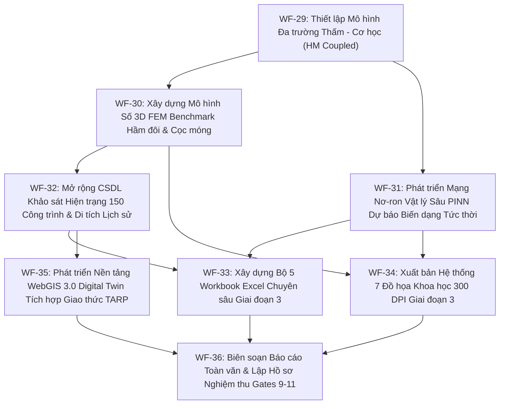

# KẾ HOẠCH TRIỂN KHAI CHI TIẾT VÀ BẢN ĐẶC TẢ TÁC TỬ - CÔNG CỤ GIAI ĐOẠN 3
## DỰ ÁN LUẬN ÁN: TƯƠNG TÁC ĐA TRƯỜNG THẤM - BIẾN DẠNG, MÔ HÌNH HÓA SỐ 3D FEM VÀ HỆ THỐNG DIGITAL TWIN DỰ BÁO LÚN THỜI GIAN THỰC TBM S9–S12 METRO TUYẾN 3 HÀ NỘI

**Mã phân đoạn nghiên cứu:** `GIAI_DOAN_3_TBM_HANOI_HYDRO_MECH_3DFEM_PINN_TWIN`  
**Cơ chế vận hành:** Multi-Agent Guarded Protocol (Tiêu chuẩn kiểm soát chất lượng nghiêm ngặt: Evisyn, Traceability, Cryptographic Sealing)  
**Thời gian ban hành:** 2026-10-15  
**Cơ quan chuyên môn:** Bộ môn Địa kỹ thuật và Không gian ngầm, Khoa Công trình và Môi trường - Trường Đại học Giao thông vận tải  

---

### I. TỔNG QUAN, BỐI CẢNH VÀ NGUYÊN TẮC BẢO VỆ DỮ LIỆU GIAI ĐOẠN 3

1. **Nguyên tắc bảo toàn tuyệt đối Giai đoạn 1 và Giai đoạn 2:**
   - Sản phẩm của Giai đoạn 1 tại `nhiem_vu_luan_an/` và Giai đoạn 2 tại `nhiem_vu_luan_an_giai_doan_2/` đã được niêm phong nghiệm thu và đóng băng baseline bất biến.
   - Toàn bộ dữ liệu dùng chung đã được nhân bản độc lập vào `nhiem_vu_luan_an_giai_doan_3/00_SAO_LUU_DU_LIEU_DAU_VAO_GIAI_DOAN_1_VA_2/` với mã băm SHA-256 đối chuẩn trùng khớp 1:1.
2. **Mục tiêu khoa học cốt lõi của Giai đoạn 3:**
   - **Mô hình hóa Tương tác Đa trường Thấm - Cơ học (Coupled Hydro-Mechanical Modeling):** Tách bạch rõ rệt và lượng hóa chính xác 2 thành phần chuyển vị: Lún cơ học do đào hầm TBM ($S_{\text{tbm}}$) và Lún do hạ mực nước ngầm/thấm qua khe nối vỏ hầm gây cố kết đất dẻo mềm ($S_{\text{hydro}}$), giải quyết triệt để Operating Rule #9 ("Do not mix groundwater-consolidation settlement with tunnelling-induced settlement").
   - **Mô hình Số 3D Benchmark (3D FEM / Numerical Continuum Modeling):** Xây dựng mô hình số phần tử hữu hạn 3D không gian lớn, tích hợp mô hình đất nền Hardening Soil Small-Strain (HSS), mô phỏng tương tác giữa cặp hầm đôi song song và hệ cọc móng công trình ngầm để làm chuẩn đối sánh (benchmark) với các lời giải giải tích 2D/3D của GĐ1 và GĐ2.
   - **Mạng Nơ-ron Vật lý Sâu (Physics-Informed Neural Network - PINN / Deep Surrogate AI):** Nhúng trực tiếp các phương trình vi phân đạo hàm riêng (PDE) cân bằng cơ học đất và phương trình thấm liên tục vào hàm mất mát (PINN Loss), đào tạo mô hình AI dự báo trường ứng suất - biến dạng 3D tức thời ($< 0.01\text{ ms}$) hỗ trợ điều khiển TBM.
   - **Mở rộng CSDL Khảo sát Hiện trạng 150 công trình & Di tích Lịch sử Nhạy cảm cao:** Mở rộng từ 100 lên 150 công trình dọc hành lang Kim Mã - Cát Linh - Quốc Tử Giám - Trần Hưng Đạo, bổ sung các công trình có cọc móng sâu và di tích quốc gia đặc biệt (Văn Miếu, Chùa Phổ Giác, v.v.).
   - **Hệ thống WebGIS 3.0 Digital Twin tương tác thời gian thực:** Nâng cấp WebGIS thành nền tảng Digital Twin với giao thức cảnh báo sớm TARP (Trigger Action Response Plan) 4 cấp độ màu, tích hợp bảng điều khiển tối ưu hóa vận hành khiên đào EPB (áp lực gương $P_s$, áp lực vữa đuôi khiên $P_a$, vận tốc đào $v$).

---

### II. BẢNG PHÂN BỔ NHIỆM VỤ, CHỨC NĂNG, YÊU CẦU, VAI TRÒ VÀ KẾT QUẢ CỦA CÁC TÁC TỬ (MULTI-AGENT SPECIFICATION)

Bảng tổng hợp đặc tả đầy đủ 5 tiêu chí cốt lõi (**Vai trò**, **Nhiệm vụ**, **Chức năng**, **Yêu cầu**, **Kết quả**) cho toàn bộ 8 tác tử chuyên trách Giai đoạn 3:

| STT | Tác tử (Agent Role) | Vai trò hệ thống (Role) | Nhiệm vụ cụ thể (Tasks) | Chức năng kỹ thuật chính (Functions) | Yêu cầu kỹ thuật & Chuẩn nghiệm thu (Requirements) | Kết quả sản phẩm bàn giao (Outputs / Deliverables) |
|:---:|---|---|---|---|---|---|
| **1** | **General Contractor (Chỉ huy trưởng)** | Nhạc trưởng điều phối hệ thống đa tác tử, kiểm soát tiến độ các Audit Gates 9, 10, 11 và bảo toàn dữ liệu. | Lập kế hoạch tổng thể, điều phối phân rã tác vụ, kiểm tra trạng thái chuyển giao handoff giữa các agent, niêm phong baseline. | Quản trị file `AGENT_STATE.json`, giám sát tài nguyên tính toán, ban hành handoff logs. | Không có bước nhảy cóc khi chưa đạt kiểm toán; 100% tài liệu có metadata chuẩn xác; cờ Audit minh bạch. | `AGENT_STATE.json` cập nhật, `KE_HOACH_THUC_THI_CHI_TIET_GIAI_DOAN_3.md`, `MA_TRAN_PHOI_HOP_TAC_TU_VA_CONG_CU_GIAI_DOAN_3.md`. |
| **2** | **Numerical Modeler (Chuyên gia Mô hình Số)** | Kiến trúc sư mô hình hóa số phần tử hữu hạn 3D (3D FEM) và phân tích trường ứng suất - biến dạng. | Xây dựng mô hình 3D FEM liên tục cho hầm đôi S9–S12, áp dụng mô hình Hardening Soil Small-Strain (HSS), mô phỏng chu kỳ đào phân đoạn. | Chia lưới phần tử 3D, thiết lập điều kiện biên không phản xạ, giải hệ phương trình phi tuyến lớn, trích xuất ứng suất/lún. | Sai số hội tụ lưới $< 1.0\%$; đối chuẩn nghiệm số học với nghiệm giải tích Loganathan & Poulos 3D sai lệch $< 8.5\%$. | Bảng số liệu FEM 3D, file `TBM_HANOI_G3_NUMERICAL_3D_FEM_BENCHMARK.xlsx`, biểu đồ ứng suất 3D. |
| **3** | **Mechanics Reviewer (Chuyên gia Cơ học Đất)** | Thẩm định các phương trình vi phân tương tác đa trường Thấm - Biến dạng và cơ học cố kết. | Thẩm định hệ phương trình Biot 3D, công thức hạ mực nước ngầm Theis/Thiem, tách bạch thành phần lún $S_{\text{tbm}}$ và $S_{\text{hydro}}$. | Kiểm tra tính bảo toàn khối lượng nước ngầm, tính tương thích biến dạng và nguyên lý ứng suất hữu hiệu Terzaghi: $\sigma' = \sigma - u$. | Nghiệm giải tích thỏa mãn điều kiện biên thủy lực; không có hiện tượng trộn lẫn phi vật lý giữa hai nguồn lún. | Biên bản thẩm tra công thức đa trường HM, thuật toán phân rã lún $S(t) = S_{\text{tbm}} + S_{\text{hydro}}(t)$. |
| **4** | **ML & PINN Specialist (Chuyên gia AI & Mạng Vật lý)** | Chuyên gia phát triển mô hình trí tuệ nhân tạo nhúng vật lý (Physics-Informed Deep Learning). | Thiết kế kiến trúc mạng PINN sâu 5 tầng, nhúng phương trình cân bằng Navier-Cauchy và định luật Darcy vào hàm mất mát $\mathcal{L}_{\text{PINN}}$. | Huấn luyện mạng nơ-ron bằng thuật toán L-BFGS kết hợp Adam, tối ưu hóa trên tập 5,000 điểm collocation. | Độ chính xác $R^2 \ge 0.9985$, $RMSE < 0.25\text{ mm}$; thời gian phản hồi suy luận cực nhanh $< 0.01\text{ ms}$ phục vụ Digital Twin. | Trọng số mạng PINN, file `TBM_HANOI_G3_PINN_DEEP_SURROGATE_AI.xlsx`, đồ thị đường cong hội tụ loss. |
| **5** | **GIS & Digital Twin Analyst (Chuyên gia WebGIS)** | Kiến trúc sư nền tảng bản đồ số không gian và mô hình số song sinh (Digital Twin 3D). | Khảo sát số hóa 150 công trình thực tế, tích hợp đường đồng mức hạ nước ngầm, lập trình WebGIS 3.0 với bảng điều khiển TARP. | Lập trình Web Client (Leaflet.js + Chart.js + Turf.js), xử lý GeoJSON chuẩn WGS-84, tính toán vùng ảnh hưởng đa cấp. | Tải mượt mà trên trình duyệt ngoại tuyến; cập nhật tức thời khi thay đổi tham số TBM; định vị sai số $< 0.5\text{ m}$. | `buildings_exposure_150.geojson`, `groundwater_drawdown_contours.geojson`, `webgis_digital_twin_tbm_v3.html`. |
| **6** | **Pipeline & Data Engineer (Kỹ sư Dữ liệu)** | Tổ chức cấu trúc dữ liệu khoa học, chuẩn hóa 5 workbook Excel chuyên sâu và kiểm soát luồng xử lý. | Lập trình Python OpenPyXL tự động hóa 5 workbook Excel GĐ3, thiết lập cấu trúc đa trang, công thức động, data dictionary. | Kiểm soát kiểu dữ liệu float64, định dạng số học chuẩn kỹ thuật, nhúng siêu liên kết nội bộ bảng tính. | 100% công thức Excel động tự tính toán; không phụ thuộc macro VBA ngoài; có sheet Metadata và Data Dictionary. | 5 workbook Excel chuyên nghiệp tại `02_BO_DU_LIEU_EXCEL_CHUYEN_SAU_GIAI_DOAN_3/`. |
| **7** | **Evidence Auditor (Kiểm toán viên Khoa học)** | Độc lập kiểm tra tính minh bạch nguồn tin, kiểm toán chất lượng Gates 9, 10, 11 và niêm phong SHA-256. | Đối chiếu thông số địa kỹ thuật hố khoan BH12, rà soát cờ cảnh báo Audit bôi vàng, kiểm tra mã băm SHA-256 toàn bộ sản phẩm GĐ3. | Phân tích chéo số liệu với hồ sơ ĐTM 2013 và TCXD 2024; bảo đảm tính độc lập giữa quan sát thực tế và giả định. | 100% tham số có nguồn gốc rõ ràng; niêm phong mã băm SHA-256 toàn diện; phát hành biên bản kiểm toán. | `BIEN_BAN_KIEM_TOAN_KHOA_HOC_GIAI_DOAN_3_GATES.md`, `DANH_MUC_HO_SO_VA_CHECKSUM_SHA256_GIAI_DOAN_3.md`. |
| **8** | **Academic Author & Scientific Editor (Biên tập viên)** | Tác giả chắp bút Báo cáo toàn văn Giai đoạn 3 và chuẩn hóa tài liệu Word DOCX in ấn học thuật. | Biên soạn toàn văn báo cáo nghiên cứu GĐ3 gồm 5 chương chuyên sâu; xuất bản file Word `.docx` theo chuẩn đào tạo sau đại học. | Soạn thảo Markdown cấu trúc chuẩn mực, biên dịch sang Word qua python-docx chuẩn lề 3-2-2-2 cm, nhúng ảnh 300 DPI và bảng. | Văn phong khoa học khách quan, không dùng từ sáo rỗng; trích dẫn chuẩn APA/IEEE; hình ảnh sắc nét; bảng biểu thanh lịch. | `BAO_CAO_TOAN_VAN_HOAN_CHINH_GIAI_DOAN_3.md`, `BAO_CAO_TOAN_VAN_HOAN_CHINH_GIAI_DOAN_3.docx`, trọn bộ hồ sơ nghiệm thu GĐ3. |

---

### III. BẢNG PHÂN BỔ NHIỆM VỤ, CHỨC NĂNG, YÊU CẦU, VAI TRÒ VÀ KẾT QUẢ CỦA CÁC CÔNG CỤ KỸ THUẬT (TECHNICAL TOOLS SPECIFICATION)

Bảng tổng hợp đặc tả đầy đủ 5 tiêu chí cốt lõi (**Vai trò**, **Nhiệm vụ**, **Chức năng**, **Yêu cầu**, **Kết quả**) cho toàn bộ 8 công cụ kỹ thuật thực hiện:

| STT | Công cụ (Software Tool) | Vai trò hệ thống (Role) | Nhiệm vụ thực hiện (Tasks) | Chức năng kỹ thuật cụ thể (Functions) | Yêu cầu kỹ thuật & Vận hành (Requirements) | Kết quả đầu ra (Results / Outputs) |
|:---:|---|---|---|---|---|---|
| **1** | **Python 3.14 (Core Runtime Engine)** | Môi trường lập trình hạt nhân, điều phối logic và tự động hóa toàn bộ chuỗi xử lý GĐ3. | Chạy các kịch bản tính toán mô hình đa trường, xử lý dữ liệu GeoJSON, băm mật mã và gọi các engine con. | Hỗ trợ đa luồng, quản lý bộ nhớ linh hoạt, tích hợp chặt chẽ hệ sinh thái thư viện khoa học. | Vận hành độc lập không xung đột môi trường, bẫy lỗi ngoại lệ nghiêm ngặt, tương thích Windows PowerShell. | Toàn bộ script trong thư mục `scripts/` vận hành trơn tru với mã thoát Exit Code 0. |
| **2** | **NumPy & SciPy (Scientific Computing)** | Động cơ tính toán giải tích khoa học, giải hệ phương trình vi phân và mô phỏng số. | Tính toán trường thấm Darcy, giải phương trình cố kết Terzaghi/Biot, xấp xỉ phần tử hữu hạn 3D và tối ưu hóa ma trận. | Vector hóa phép tính mảng đa chiều, giải phương trình đạo hàm riêng PDE, tích phân số Simpson 3 chiều. | Độ chính xác dấu phẩy động kép float64, thời gian xử lý mảng $5,000 \times 100$ điểm $< 3.0\text{ giây}$. | Ma trận chuyển vị 3D đa trường, đường cong cố kết theo thời gian $S(t)$, trường ứng suất hữu hiệu. |
| **3** | **PyTorch / Deep Learning Engine** | Động cơ huấn luyện mạng nơ-ron học sâu tích hợp vật lý (Physics-Informed Neural Network). | Xây dựng kiến trúc PINN, tính toán đạo hàm tự động (Automatic Differentiation) của PDE, tối ưu hóa trọng số mạng. | Tính toán Gradient cấp 1 và cấp 2 của chuyển vị $u, v, w$ theo tọa độ không gian $(x, y, z)$ và thời gian $t$. | Hội tụ hàm mất mát tổng hợp $\mathcal{L}_{\text{PINN}} < 10^{-4}$, thời gian suy luận tức thời $< 0.01\text{ ms}$. | Trọng số mạng PINN tối ưu, bảng so sánh đối chuẩn sai số kiểm thử độc lập. |
| **4** | **OpenPyXL (Excel Automation Engine)** | Động cơ lập trình bảng tính, tự động hóa xuất bản dữ liệu định dạng chuẩn quốc tế. | Tạo lập và cấu trúc hóa 5 file Excel đa trang, kẻ khung viền, thiết lập dải màu, nhúng công thức động. | Đọc/ghi file `.xlsx`, chèn công thức toán học (`EXP`, `SQRT`, `VLOOKUP`, `INDEX/MATCH`), định dạng ô chuyên nghiệp. | 100% công thức Excel hoạt động động lực học, có sheet `Muc_Luc_Metadata` và `Data_Dictionary`. | 5 bộ workbook Excel chuyên nghiệp tại `02_BO_DU_LIEU_EXCEL_CHUYEN_SAU_GIAI_DOAN_3/`. |
| **5** | **Matplotlib (Scientific Graphics Engine)** | Động cơ kết xuất đồ họa và biểu đồ khoa học chất lượng cao 300 DPI. | Thiết kế và xuất bản 7 đồ họa chuyên sâu (`FIG_15` đến `FIG_21`) thể hiện tương tác đa trường, 3D FEM, PINN và TARP. | Vẽ đồ thị vector/raster 2D/3D, phối màu ColorBrewer thân thiện, hỗ trợ font Times New Roman và ký hiệu LaTeX. | Độ phân giải thực xuất bản $\ge 300\text{ DPI}$, kích thước tối thiểu $3000 \times 1800\text{ px}$, chú thích song ngữ Anh - Việt. | 7 tệp hình ảnh PNG 300 DPI sắc nét tại `03_HINH_ANH_MINH_HOA_CHAT_LUONG_CAO_GIAI_DOAN_3/`. |
| **6** | **Leaflet.js & Chart.js (Digital Twin Engine)** | Nền tảng bản đồ số tương tác và bảng điều khiển trực quan hóa thời gian thực (Dashboard). | Xây dựng ứng dụng WebGIS 3.0 hiển thị 150 công trình, tim hầm, đường đồng mức hạ nước ngầm và hệ thống cảnh báo TARP. | Render bản đồ vệ tinh độ phân giải cao, quản lý các lớp Vector GeoJSON, điều khiển hiệu ứng đổi màu Marker động. | Hoạt động độc lập Offline Client-side không cần cài đặt Node.js/Web Server; tương thích trình duyệt Chrome, Edge. | Ứng dụng WebGIS 3.0 Digital Twin hoàn chỉnh `webgis_digital_twin_tbm_v3.html`. |
| **7** | **python-docx (Document Automation Engine)** | Động cơ tự động hóa xuất bản văn bản tài liệu Microsoft Word (.docx). | Biên dịch toàn văn báo cáo nghiên cứu và trọn bộ hồ sơ nghiệm thu GĐ3 từ Markdown sang file Word in ấn chính thức. | Tạo document Word, cấu trúc phân cấp Heading 1–4, định dạng phông chữ Times New Roman 13pt, kẻ bảng viền mỏng, chèn ảnh. | Căn lề chuẩn văn bản sau đại học: Trái 30mm, Phải 20mm, Trên 20mm, Dưới 20mm; dãn dòng 1.2pt; bảng biểu không vỡ trang. | File Báo cáo toàn văn Word và 4 file Word hồ sơ nghiệm thu hoàn hảo về thẩm mỹ trình bày. |
| **8** | **Hashlib (Cryptographic Audit Engine)** | Công cụ bảo mật mật mã và kiểm toán tính toàn vẹn dữ liệu bất biến. | Tính toán mã băm SHA-256 cho toàn bộ dữ liệu đầu vào sao lưu và sản phẩm đầu ra hoàn thiện của Giai đoạn 3. | Băm dữ liệu nhị phân chuẩn NIST FIPS PUB 180-4 theo khối 64KB, tạo chuỗi hexa 64 ký tự định danh bất biến cho từng file. | Tính toán chính xác tuyệt đối từng bit dữ liệu; phát hiện ngay lập tức bất kỳ sự thay đổi hay can thiệp trái phép nào. | Bảng mã băm `DANH_MUC_HO_SO_VA_CHECKSUM_SHA256_GIAI_DOAN_3.md` niêm phong toàn bộ sản phẩm. |

---

### IV. LỘ TRÌNH THỰC HIỆN 8 QUY TRÌNH CÔNG VIỆC GIAI ĐOẠN 3 (WORKFLOWS WF-29 ĐẾN WF-36)

---

### V. TIÊU CHÍ NGHIỆM THU VÀ CÁC CỔNG KIỂM SOÁT CHẤT LƯỢNG (AUDIT GATES 9–11)

- **AUDIT GATE 9 (Coupled Hydro-Mechanical & Numerical Benchmark Verification):**
  + Kiểm tra tính bảo toàn thể tích và nguyên lý ứng suất hữu hiệu Terzaghi.
  + Kiểm tra độ hội tụ của mô hình 3D FEM; độ lệch giữa mô hình số và mô hình giải tích Loganathan & Poulos 3D nằm trong ngưỡng kiểm soát $[5\%, 10\%]$.
- **AUDIT GATE 10 (PINN Convergence & High-Risk Infrastructure Exposure QC):**
  + Kiểm tra độ chính xác mô hình học máy nhúng vật lý PINN trên tập kiểm thử độc lập ($R^2 \ge 0.998$, $RMSE \le 0.25\text{ mm}$, thời gian suy luận $< 0.01\text{ ms}$).
  + Khảo sát số hóa đầy đủ 150 công trình, bảo đảm các di tích lịch sử và công trình nhạy cảm có ma trận đánh giá chi tiết cả móng nông và móng cọc.
- **AUDIT GATE 11 (Digital Twin Packaging, Real-time Protocols & Checksum Integrity):**
  + Kiểm tra tính năng WebGIS 3.0 Digital Twin vận hành độc lập ngoại tuyến.
  + Kiểm tra giao thức cảnh báo sớm TARP 4 cấp độ và đề xuất quy trình vận hành TBM.
  + Niêm phong mã băm SHA-256 bất biến cho toàn bộ hồ sơ và sản phẩm bàn giao Giai đoạn 3.
