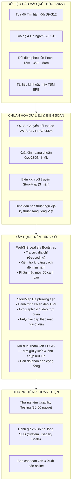

# THUYẾT MINH ĐỀ TÀI NGHIÊN CỨU KHOA HỌC CỦA SINH VIÊN
## NĂM HỌC 2026 – 2027

---

### THÔNG TIN CHUNG VỀ ĐỀ TÀI

* **Tên đề tài:**  
  **"Xây dựng bản đồ số tương tác (WebGIS/StoryMap) hỗ trợ cung cấp thông tin và tham vấn cộng đồng về vùng ảnh hưởng thi công hầm Metro Hà Nội"**
* **Mã số đề tài:** *SV-2026-GIS-04*
* **Lĩnh vực nghiên cứu:** Hệ thống Thông tin Địa lý (GIS) / Chuyển đổi số Quản lý Đô thị / Truyền thông Môi trường & Cộng đồng
* **Thời gian thực hiện:** 08 tháng (Từ tháng 11/2026 đến tháng 06/2027)
* **Đơn vị chủ trì:** Bộ môn Địa kỹ thuật & Không gian ngầm / Khoa Công trình & Môi trường (phối hợp Khoa CNTT)
* **Giảng viên hướng dẫn (Tổng thầu khoa học):** TS. Nguyễn Hải Hà (Chủ nhiệm Đề tài T2027 TBM_ĐTM)
* **Nhóm sinh viên thực hiện (Nhóm 2–3 sinh viên yêu thích công nghệ, đồ họa bản đồ và truyền thông số):**
  1. **Sinh viên 1 (Trưởng nhóm - Biên tập Nội dung & Tham vấn Cộng đồng):** Điều phối tiến độ, biên tập kịch bản StoryMap, chuyển hóa thuật ngữ địa kỹ thuật sang ngôn ngữ đại chúng, thiết kế phiếu tham vấn cộng đồng trực tuyến (PPGIS), tổng hợp báo cáo.
  2. **Sinh viên 2 (Kỹ thuật GIS & Nền tảng Bản đồ số WebGIS):** Chuẩn hóa tọa độ WGS-84/VN-2000, số hóa tuyến hầm, vị trí ga và vùng đệm lún (15m, 35m, 50m); thiết lập bản đồ trên nền tảng No-code/Low-code (Google My Maps, ArcGIS Online StoryMaps, Leaflet JS); tích hợp công cụ định vị và tra cứu địa chỉ nhà dân.
  3. **Sinh viên 3 (Đồ họa UI/UX & Truyền thông Đa phương tiện - nếu có 3 thành viên):** Thiết kế giao diện thân thiện cho thiết bị di động, xây dựng Infographic minh họa cấu tạo máy đào hầm TBM, biên tập video/hình ảnh thực tế thi công, hỗ trợ kiểm thử người dùng (Usability Testing).

---

### PHẦN I: TÍNH CẤP THIẾT VÀ TỔNG QUAN VẤN ĐỀ NGHIÊN CỨU

#### 1.1. Tính cấp thiết của đề tài

1. **Bối cảnh thực tiễn của Dự án Tuyến Metro số 3 Hà Nội (Nhổn – Ga Hà Nội):**  
   Đoạn tuyến ngầm dài 4,0 km từ Ga S9 (Kim Mã) đến Ga S12 (Ga Hà Nội) đang được thi công bằng hai máy đào hầm cân bằng áp lực đất (EPB-TBM) mang tên "Thần Tốc" và "Táo Bạo". Tuyến đi ngầm qua các khu dân cư lịch sử đông đúc bậc nhất Thủ đô (Kim Mã, Cát Linh, Quốc Tử Giám, Văn Miếu, Trần Hưng Đạo), nơi có hàng nghìn ngôi nhà phố móng nông, các chung cư cũ và di tích văn hóa đặc biệt quan trọng. Quá trình khiên đào dịch chuyển dưới lòng đất tạo ra vùng lún bề mặt tất yếu do mất thể tích đất ($V_L \approx 0{,}5\% - 2{,}0\%$).

2. **"Rào cản thông tin" và sự hoang mang trong cộng đồng dân cư:**  
   Trong thực tế, khi máy TBM tiến vào lòng đất, người dân sinh sống trên mặt đất thường nảy sinh tâm lý hoang mang, bất an:  
   * *"Nhà mình có nằm ngay trên nóc hầm hay không?"*  
   * *"Nhà mình cách tim hầm bao nhiêu mét và có nguy cơ bị nứt, lún hay không?"*  
   * *"Khi nào máy đào hầm sẽ đi qua vị trí nhà mình và nếu xảy ra sự cố nứt tường thì báo cho ai?"*  
   Hiện nay, các báo cáo kỹ thuật địa kỹ thuật, báo cáo Đánh giá tác động môi trường (ĐTM) hoặc các hồ sơ thiết kế thi công chứa đựng lượng dữ liệu khoa học rất lớn nhưng được trình bày bằng ngôn ngữ chuyên ngành phức tạp (biểu đồ lún giải tích Peck, ma trận ứng suất - biến dạng, hệ số thể tích lún $V_L$, bán kính phễu lún $i$,...). Người dân thông thường không thể tự đọc hiểu và không biết tìm kiếm thông tin ở đâu.

3. **Xu thế Chuyển đổi số và Hệ thống GIS có sự tham gia của cộng đồng (PPGIS - Public Participatory GIS):**  
   Nghị quyết số 52-NQ/TW của Bộ Chính trị về chủ động tham gia cuộc Cách mạng công nghiệp lần thứ tư và Đề án Chuyển đổi số Quốc gia đều nhấn mạnh việc "Lấy người dân làm trung tâm", cung cấp dịch vụ công và thông tin quy hoạch minh bạch trên nền tảng số. Trong lĩnh vực quản lý đô thị hiện đại, mô hình **PPGIS (Public Participatory GIS)** và **StoryMap (Bản đồ kể chuyện số)** đã trở thành công cụ tiêu chuẩn quốc tế giúp thu hẹp khoảng cách giữa giới khoa học công trình, ban quản lý dự án và người dân.

4. **Giải pháp No-code / Low-code – Đột phá vừa sức cho nghiên cứu khoa học sinh viên:**  
   Thay vì phải đầu tư hệ thống máy chủ phức tạp hay lập trình hàng nghìn dòng mã nguồn backend nặng nề, hiện nay các công nghệ WebGIS mã nguồn mở và nền tảng No-code/Low-code (như ArcGIS Online StoryMaps, Leaflet Web Template, Google My Maps API) cho phép sinh viên nhanh chóng xây dựng các ứng dụng bản đồ tương tác trực quan cao, chạy mượt mà trên điện thoại thông minh chỉ sau vài tuần tiếp cận.

5. **Kết luận về tính cấp thiết:**  
   Đề tài mang tính tiên phong, kết hợp hài hòa giữa **Kỹ thuật công trình ngầm** (kế thừa kết quả mô hình lún từ Đề tài lớn T2027) với **Công nghệ thông tin địa lý (WebGIS)** và **Truyền thông cộng đồng**. Kết quả đề tài không chỉ là một sản phẩm học thuật xuất sắc của sinh viên mà còn trực tiếp đóng góp một công cụ số nhân văn, thiết thực cho cộng đồng cư dân Hà Nội.

#### 1.2. Tổng quan tình hình nghiên cứu

* **Nghiên cứu quốc tế về PPGIS và StoryMap trong hạ tầng đô thị:**  
  - *Sieber (2006), Brown & Kyttä (2014):* Xác lập khung lý thuyết về PPGIS, chỉ rõ bản đồ số tương tác giúp tăng cường sự tham gia của người dân, nâng cao tính minh bạch và giảm thiểu xung đột xã hội trong các dự án quy hoạch hạ tầng lớn.  
  - *ESRI StoryMaps (2018–nay):* Được ứng dụng rộng rãi tại các dự án metro ở London (Crossrail), Singapore (LTA Thomson-East Coast Line), Sydney Metro nhằm cung cấp bản đồ thời gian thực về tiến độ khiên đào TBM, các mốc thời gian máy đi qua từng khu dân cư và chỉ dẫn an toàn cho người dân.  
  - *Mowbray et al. (2021):* Phân tích hiệu quả của bản đồ WebGIS Low-code dựa trên Leaflet trong việc phổ biến rủi ro thiên tai và lún sụt đô thị cho cộng đồng không chuyên môn.

* **Nghiên cứu trong nước & Kế thừa từ Đề tài mẹ T2027:**  
  - Tại Việt Nam, hầu hết các ứng dụng WebGIS giao thông mới dừng lại ở bản đồ tìm tuyến xe buýt hoặc tra cứu quy hoạch đất đai dạng tĩnh. Chưa có ứng dụng WebGIS chuyên biệt nào phục vụ việc **truyền thông rủi ro lún sụt và tham vấn cộng đồng theo thời gian thực** cho dự án thi công hầm TBM.  
  - **Mối liên hệ kế thừa với Đề tài mẹ T2027:** Đề tài lớn T2027 của Giảng viên hướng dẫn đã hoàn thành việc tính toán giải tích phễu lún Peck (1969) và Loganathan & Poulos (1998), xác lập 3 dải ranh giới lún quan trọng dọc tuyến S9–S12:  
    + *Dải 15m (Zone 1 - Vùng giám sát đặc biệt):* Nằm trực diện trên nóc hầm, độ lún lớn nhất $S_{max} > 10 - 15\,\text{mm}$.  
    + *Dải 35m (Zone 2 - Vùng phễu lún ảnh hưởng chính):* Tương ứng phạm vi $2{,}5i - 3i$ của phễu lún Peck, có nguy cơ lún chênh lệch tác động đến móng nông.  
    + *Dải 50m (Zone 3 - Vùng đệm mở rộng / kiểm soát phụ trợ):* Vùng an toàn, biến dạng lún nhỏ ($< 2 - 3\,\text{mm}$).  
  - Đề tài NCKHSV này sẽ kế thừa nguyên vẹn cơ sở dữ liệu ranh giới vùng lún chuẩn hóa của T2027 để đưa lên nền tảng WebGIS tương tác, phục vụ công chúng.

---

### PHẦN II: MỤC TIÊU, ĐỐI TƯỢNG VÀ PHẠM VI NGHIÊN CỨU

#### 2.1. Mục tiêu nghiên cứu

* **Mục tiêu tổng quát:**  
  Ứng dụng các nền tảng công nghệ No-code/Low-code để xây dựng một Hệ thống bản đồ số tương tác (WebGIS) kết hợp Bản đồ kể chuyện (StoryMap), cung cấp thông tin trực quan, minh bạch về hướng tuyến, tiến độ đào hầm TBM và các vùng dự báo ảnh hưởng lún; đồng thời tích hợp kênh thu nhận phản ánh, ý kiến đóng góp của cộng đồng cư dân dọc hành lang Tuyến Metro số 3 Hà Nội (đoạn S9–S12).

* **Mục tiêu cụ thể:**  
  1. *Mục tiêu 1:* Thu thập, chuẩn hóa tọa độ không gian (WGS-84) và xây dựng bộ cơ sở dữ liệu GIS chuẩn định dạng GeoJSON bao gồm: tim tuyến hầm đôi, vị trí 4 ga ngầm (S9, S10, S11, S12), các dải đệm vùng ảnh hưởng lún (15m, 35m, 50m) và các công trình di tích / điểm nhạy cảm.  
  2. *Mục tiêu 2:* Thiết kế và xây dựng Bản đồ số tương tác (WebGIS) tích hợp tính năng tra cứu địa chỉ tự động ("Nhà tôi có an toàn không?"), đo khoảng cách đến tim hầm và hiển thị giải thích mức độ rủi ro bằng ngôn ngữ đại chúng.  
  3. *Mục tiêu 3:* Xây dựng Bản đồ kể chuyện đa phương tiện (StoryMap) với cốt truyện "Hành trình máy TBM đi ngầm dưới lòng Hà Nội", giải thích cấu tạo khiên đào, cơ chế cân bằng áp lực đất và các giải pháp bảo đảm an toàn của dự án.  
  4. *Mục tiêu 4:* Thiết kế mô-đun tham vấn cộng đồng (PPGIS Feedback) và tổ chức thử nghiệm đánh giá khả năng sử dụng (Usability Test) trên nhóm người dùng đại diện (30–50 người dân và sinh viên).

#### 2.2. Đối tượng và phạm vi nghiên cứu

* **Đối tượng nghiên cứu:**  
  - Dữ liệu không gian về hướng tuyến hầm TBM, ga ngầm và vùng đệm phễu lún mặt đất.  
  - Giao diện người dùng (UI/UX) của bản đồ số tương tác và bản đồ kể chuyện (StoryMap) trên nền tảng Web/Mobile.  
  - Mức độ tiếp nhận thông tin, nhận thức an toàn và nhu cầu phản ánh của cộng đồng cư dân đô thị.

* **Phạm vi không gian:**  
  Hành lang đoạn tuyến ngầm Metro số 3 Hà Nội (từ Ga S9 Kim Mã qua Ga S10 Cát Linh, Ga S11 Văn Miếu đến Ga S12 Ga Hà Nội), mở rộng sang hai bên tim hầm một dải đệm $50\,\text{m}$.

* **Phạm vi thời gian:**  
  Dữ liệu không gian và kịch bản thi công được thu thập, chuẩn hóa và thử nghiệm trong giai đoạn từ tháng 11/2026 đến tháng 06/2027.

---

### PHẦN III: CÁCH TIẾP CẬN VÀ PHƯƠNG PHÁP NGHIÊN CỨU

#### 3.1. Cách tiếp cận nghiên cứu

Đề tài tiếp cận theo hướng **"Lấy người dùng làm trung tâm (User-Centered Design)"** và **"Công nghệ No-code/Low-code tinh gọn (Lean No-code GIS)"**:

#### 3.2. Hệ thống phương pháp nghiên cứu cụ thể

1. **Phương pháp kế thừa và phân tích dữ liệu thứ cấp:**  
   Kế thừa trực tiếp các tọa độ tuyến và kết quả phân tích giải tích phễu lún từ Đề tài lớn T2027 của Giảng viên hướng dẫn, đảm bảo tính chuẩn xác khoa học và tuân thủ các quy chuẩn bảo mật dự án.

2. **Phương pháp mô hình hóa dữ liệu không gian (Spatial Data Modeling) bằng phần mềm mã nguồn mở:**  
   Sử dụng QGIS (miễn phí, mã nguồn mở) để:
   - Chuyển đổi hệ tọa độ VN-2000 kinh tuyến trục $105^\circ$ về WGS-84 (EPSG:4326) tương thích hoàn hảo với bản đồ web vệ tinh (OpenStreetMap, Esri Satellite, Google Maps).
   - Tạo các vùng đệm tự động (Buffer zones): $15\,\text{m}$ (Vùng giám sát đặc biệt), $35\,\text{m}$ (Vùng ảnh hưởng lún Peck), $50\,\text{m}$ (Vùng đệm quan trắc mở rộng).
   - Đóng gói dữ liệu dạng GeoJSON gọn nhẹ ($< 2\,\text{MB}$), giúp tải cực nhanh trên thiết bị di động 3G/4G.

3. **Phương pháp phát triển WebGIS Low-code / No-code:**  
   - *Tùy chọn No-code:* Xây dựng bản đồ Google My Maps và ArcGIS Online StoryMaps (kéo thả giao diện, không cần viết code).
   - *Tùy chọn Low-code (Sản phẩm cốt lõi):* Sử dụng thư viện JavaScript mã nguồn mở Leaflet kết hợp khung giao diện Bootstrap 5 hiện đại. Tích hợp plugin định vị GPS của trình duyệt (HTML5 Geolocation) và dịch vụ tìm kiếm địa chỉ Nominatim/OpenStreetMap (miễn phí, không tốn phí API key).

4. **Phương pháp biên kịch Storytelling (Truyền thông khoa học bằng câu chuyện):**  
   Xây dựng kịch bản 4 phân đoạn:
   - *Màn 1: Vì sao Hà Nội cần tàu điện ngầm và vì sao phải đào hầm ngầm qua phố cổ?*
   - *Màn 2: Cận cảnh hai "chú robot khổng lồ" TBM Thần Tốc và Táo Bạo đang làm việc thế nào dưới lòng đất sâu 15–18 mét?*
   - *Màn 3: Hiện tượng lún mặt đất là gì? Công nghệ kiểm soát an toàn của dự án hiện đại ra sao?*
   - *Màn 4: Nhà bạn ở đâu trên hành trình này? Hướng dẫn tra cứu và các kênh liên hệ khẩn cấp.*

5. **Phương pháp điều tra trải nghiệm người dùng (Usability Testing & SUS Scale):**  
   Mời đại diện người dân dọc tuyến Kim Mã – Cát Linh và sinh viên tham gia trải nghiệm ứng dụng WebGIS trên điện thoại di động; đánh giá độ tiện dụng thông qua thang đo tiêu chuẩn quốc tế SUS (System Usability Scale - 10 câu hỏi đánh giá giao diện).

---

### PHẦN IV: NỘI DUNG NGHIÊN CỨU CHI TIẾT (KẾT CẤU 4 CHƯƠNG)

* **CHƯƠNG 1: CƠ SỞ LÝ LUẬN VỀ GIS CỘNG ĐỒNG (PPGIS) VÀ TRUYỀN THÔNG RỦI RO TRONG CÁC DỰ ÁN HẦM ĐÔ THỊ**
  - 1.1. Khái niệm và vai trò của PPGIS trong quản lý và tham vấn cộng đồng đô thị.
  - 1.2. Tổng quan về công nghệ thi công hầm khiên đào TBM và hiện tượng biến dạng lún mặt đất đô thị.
  - 1.3. Khoảng trống truyền thông rủi ro công trình ngầm tại Việt Nam và sự cần thiết của giải pháp bản đồ số.
  - 1.4. Đánh giá ưu nhược điểm của các nền tảng WebGIS No-code và Low-code (Google My Maps, ArcGIS StoryMaps, Leaflet JS).

* **CHƯƠNG 2: THU THẬP, CHUẨN HÓA VÀ XÂY DỰNG CƠ SỞ DỮ LIỆU KHÔNG GIAN HÀNH LANG TUYẾN S9–S12**
  - 2.1. Tiếp nhận và kiểm định tọa độ hướng tuyến hầm đôi từ Đề tài lớn T2027.
  - 2.2. Xây dựng các lớp dữ liệu không gian: Tim hầm, 4 ga ngầm (S9–S12), ranh giới các vùng lún (15m, 35m, 50m).
  - 2.3. Khảo sát và số hóa các điểm công trình nhạy cảm (Đền Voi Phục, Văn Miếu, các trường học, chung cư cũ).
  - 2.4. Đóng gói và tối ưu hóa bộ cơ sở dữ liệu số chuẩn GeoJSON/WGS-84.

* **CHƯƠNG 3: THIẾT KẾ VÀ PHÁT TRIỂN HỆ THỐNG BẢN ĐỒ SỐ TƯƠNG TÁC (WEBGIS) VÀ STORYMAP ĐA PHƯƠNG TIỆN**
  - 3.1. Thiết kế kiến trúc hệ thống và giao diện người dùng (UI/UX) tối ưu cho điện thoại thông minh.
  - 3.2. Xây dựng tính năng tra cứu địa chỉ tự động, kiểm tra vị trí công trình và hiển thị khuyến nghị an toàn.
  - 3.3. Biên tập và xây dựng Bản đồ kể chuyện StoryMap (hành trình khiên đào TBM, sơ đồ cấu tạo 3D, video minh họa).
  - 3.4. Tích hợp mô-đun tham vấn cộng đồng (PPGIS Feedback Form) để tiếp nhận phản ánh hiện trường.

* **CHƯƠNG 4: THỬ NGHIỆM ỨNG DỤNG, ĐÁNH GIÁ TRẢI NGHIỆM NGƯỜI DÙNG VÀ ĐỀ XUẤT GIẢI PHÁP CHUYỂN ĐỔI SỐ**
  - 4.1. Tổ chức thử nghiệm thực tế với 30–50 người dùng (cư dân và sinh viên).
  - 4.2. Phân tích kết quả khảo sát mức độ hài lòng và tính tiện dụng (Thang điểm SUS).
  - 4.3. Đánh giá khả năng chuyển giao sản phẩm cho Ban Quản lý Đường sắt Đô thị (MRB) và UBND các phường.
  - 4.4. Đề xuất quy trình số hóa truyền thông rủi ro cho các tuyến metro tương lai tại Hà Nội và TP. Hồ Chí Minh.

---

### PHẦN V: SẢN PHẨM DỰ KIẾN VÀ ĐÓNG GÓP CỦA ĐỀ TÀI

1. **Báo cáo khoa học toàn văn:**  
   01 Báo cáo tổng kết NCKHSV dày 50–70 trang, trình bày chuẩn mực theo quy định của Trường Đại học Giao thông vận tải, có mã nguồn minh bạch và các tài liệu trích dẫn khoa học chuẩn APA.

2. **Hệ thống Bản đồ số WebGIS tương tác hoàn chỉnh:**  
   - 01 Website WebGIS (mã nguồn Leaflet/Bootstrap) có thể chạy offline trên máy tính hoặc xuất bản online qua GitHub Pages / Netlify (hoàn toàn miễn phí).
   - Bản đồ có đầy đủ tính năng: Đổi lớp bản đồ vệ tinh / đường phố; Bật/tắt các lớp vùng lún; Tìm kiếm địa chỉ nhà dân; Hiển thị pop-up thông tin chi tiết; Nút gọi đường dây nóng hỗ trợ.

3. **Bản đồ kể chuyện StoryMap đa phương tiện:**  
   01 Kênh StoryMap hoàn chỉnh trên ArcGIS Online hoặc tích hợp trực tiếp trên WebGIS, gồm hình ảnh, đồ họa động và ngôn từ giải thích khoa học dễ hiểu cho người dân.

4. **Bộ cơ sở dữ liệu không gian số hóa chuẩn GeoJSON/KML:**  
   Gói dữ liệu hoàn chỉnh về đoạn hầm ngầm S9–S12 phục vụ cho các nghiên cứu tiếp theo của Nhà trường và Khoa.

5. **Công bố khoa học:**  
   01 Bài báo khoa học đăng trên Kỷ yếu Hội nghị Sinh viên Nghiên cứu Khoa học cấp Trường/Khoa năm học 2026–2027.

6. **Phát triển năng lực cho sinh viên:**  
   Trang bị cho sinh viên kỹ năng làm chủ công nghệ GIS hiện đại, tư duy chuyển đổi số, năng lực thiết kế giao diện số, kỹ năng truyền thông khoa học và kỹ năng làm việc nhóm chuyên nghiệp.

---

### PHẦN VI: DỰ TRÙ KINH PHÍ THỰC HIỆN ĐỀ TÀI

Tổng kinh phí dự kiến: **5.000.000 VNĐ** (Năm triệu đồng chẵn) từ nguồn hỗ trợ NCKHSV cấp Trường và nhóm tự chủ:
- Chi phí khảo sát tọa độ, điền dã thực tế kiểm thử người dùng: 1.500.000 VNĐ.
- Chi phí in ấn phiếu khảo sát, tài liệu thử nghiệm và kỷ yếu báo cáo: 1.500.000 VNĐ.
- Chi phí hỗ trợ người tham gia thử nghiệm trải nghiệm WebGIS: 1.000.000 VNĐ.
- Chi phí văn phòng phẩm, hoàn thiện hồ sơ nghiệm thu: 1.000.000 VNĐ.
