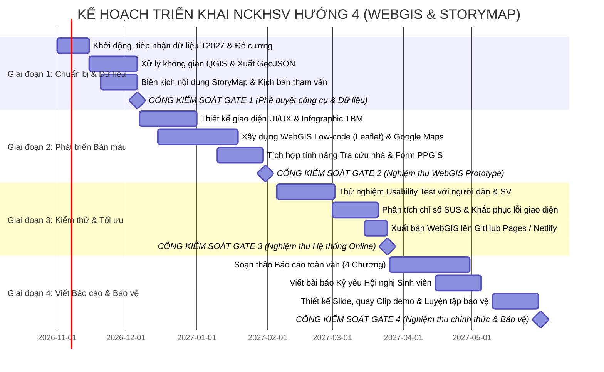

# KẾ HOẠCH TRIỂN KHAI CHI TIẾT VÀ PHÂN CÔNG NHIỆM VỤ NCKHSV
## ĐỀ TÀI: XÂY DỰNG BẢN ĐỒ SỐ TƯƠNG TÁC (WEBGIS/STORYMAP) HỖ TRỢ CUNG CẤP THÔNG TIN VÀ THAM VẤN CỘNG ĐỒNG VỀ VÙNG ẢNH HƯỞNG THI CÔNG HẦM METRO HÀ NỘI
### MÃ SỐ ĐỀ TÀI: SV-2026-GIS-04

---

### I. MÔ HÌNH VẬN HÀNH: TỔNG THẦU KHOA HỌC & NHÓM KỸ SƯ TRẺ CHUYỂN ĐỔI SỐ

Mô hình nghiên cứu được tổ chức chuyên nghiệp, kết hợp giữa sự định hướng khoa học chuẩn mực của Đề tài lớn T2027 và tính sáng tạo, linh hoạt của sinh viên:

* **Giảng viên hướng dẫn (Đóng vai trò "Tổng thầu khoa học"):**
  - Cung cấp dữ liệu gốc đã được thẩm định từ Đề tài lớn T2027 (tọa độ tim hầm đôi, tọa độ 4 ga ngầm S9–S12, bán kính các vùng lún 15m, 35m, 50m theo giải tích Peck).
  - Định hướng kiến trúc công nghệ phù hợp với năng lực sinh viên (ưu tiên giải pháp No-code/Low-code mã nguồn mở, không phát sinh chi phí duy trì máy chủ hay API trả phí).
  - Chủ trì 4 Cổng kiểm soát chất lượng (Quality Gates), hướng dẫn phương pháp viết báo cáo học thuật và phản biện thuyết trình.

* **Nhóm Sinh viên Thực hiện (2–3 Sinh viên chuyên trách):**
  - **Sinh viên 1 (Trưởng nhóm - Biên tập Nội dung & Tham vấn Cộng đồng):**
    + Chịu trách nhiệm tổng thể về tiến độ, chất lượng học thuật và tính kết nối của toàn dự án.
    + Biên kịch nội dung StoryMap: "Dịch" các khái niệm cơ học đất phức tạp (Peck, độ lún $S_{max}$, phễu lún) thành các câu chuyện ngắn gọn, hình ảnh sinh động, dễ hiểu cho người dân.
    + Thiết kế bảng hỏi tham vấn cộng đồng (Google Form tích hợp PPGIS) và câu hỏi kiểm thử giao diện (Thang đo SUS).
    + Tổng hợp, biên tập và hoàn thiện Báo cáo toàn văn NCKHSV.
  - **Sinh viên 2 (Kỹ thuật GIS & Lập trình WebGIS Low-code):**
    + Chịu trách nhiệm về cơ sở dữ liệu không gian: Chuyển đổi tọa độ sang WGS-84 (EPSG:4326), tạo vùng đệm (Buffer), đóng gói dữ liệu thành các tệp GeoJSON/KML chuẩn.
    + Xây dựng nền tảng WebGIS Leaflet / Google My Maps: Lập trình giao diện hiển thị lớp bản đồ, tính năng tìm kiếm địa chỉ (Geocoding), công cụ kiểm tra vị trí nhà dân so với tim hầm.
    + Quản trị mã nguồn trên GitHub và xuất bản ứng dụng WebGIS miễn phí lên GitHub Pages / Netlify.
  - **Sinh viên 3 (Đồ họa UI/UX, Đa phương tiện & Kiểm thử - nếu nhóm 3 thành viên):**
    + Thiết kế giao diện đồ họa (UI/UX) trên Figma/Canva, tối ưu hóa trải nghiệm vuốt chạm trên màn hình điện thoại di động.
    + Biên tập infographic trực quan về cấu tạo máy đào hầm TBM, các biện pháp an toàn và sơ đồ 4 bước phản ánh sự cố.
    + Trực tiếp điều phối khâu thử nghiệm người dùng thực tế (Usability Testing), thu thập đánh giá của người dân và sinh viên.

---

### II. BẢNG PHÂN CÔNG TRÁCH NHIỆM MA TRẬN RACI

*Quy ước ký hiệu:*  
* **R (Responsible):** Người trực tiếp thực hiện công việc.  
* **A (Accountable):** Người chịu trách nhiệm cao nhất về kết quả và kiểm tra phê duyệt.  
* **C (Consulted):** Người được tham vấn, phối hợp góp ý chuyên môn.  
* **I (Informed):** Người được thông báo tiến độ.

| STT | Gói công việc (WBS) | SV1 (Trưởng nhóm/Nội dung) | SV2 (Kỹ thuật GIS/Web) | SV3 (Đồ họa/Kiểm thử) | Giảng viên (Tổng thầu) | Sản phẩm đầu ra |
| :---: | :--- | :---: | :---: | :---: | :---: | :--- |
| **1** | Hoàn thiện Đề cương thuyết minh chi tiết | **R / A** | C | C | **Phê duyệt (Gate 1)** | Bản thuyết minh ký duyệt |
| **2** | Tiếp nhận & Kiểm tra dữ liệu tọa độ từ T2027 | C | **R / A** | I | Bàn giao & Giải thích | Bảng dữ liệu tọa độ gốc |
| **3** | Xử lý dữ liệu không gian QGIS (Tạo Buffer, GeoJSON) | I | **R / A** | C | Kiểm tra kỹ thuật | Bộ file GeoJSON/KML chuẩn |
| **4** | Biên kịch cốt truyện StoryMap (4 phân đoạn) | **R / A** | C | C | Góp ý học thuật | Kịch bản nội dung chi tiết |
| **5** | Thiết kế Infographic & Đồ họa UI/UX WebGIS | C | C | **R / A** | Góp ý thẩm mỹ | Bộ banner, icon, sơ đồ TBM |
| **6** | Phát triển bản mẫu WebGIS (Leaflet/Google Maps) | C | **R / A** | C | Đánh giá tính năng | Bản mẫu chạy thử nghiệm |
| **7** | Thiết lập mô-đun khảo sát tham vấn PPGIS | **R / A** | C (Tích hợp Web) | C | Phê duyệt câu hỏi | Form khảo sát online |
| **8** | Tổ chức thử nghiệm Usability Test (30–50 người) | C | C | **R / A** | Hỗ trợ điều phối | Dữ liệu phản hồi & điểm SUS |
| **9** | Phân tích số liệu kiểm thử & Tối ưu hóa WebGIS | C | **R (Sửa web)** | **R (Thống kê)** | Đánh giá (Gate 3) | Ứng dụng WebGIS hoàn thiện |
| **10**| Soạn thảo Báo cáo toàn văn (4 Chương) | **R / A** | R (Chương 2, 3) | R (Chương 4) | **Phản biện & Sửa chữa** | Dự thảo Báo cáo toàn văn |
| **11**| Viết bài báo khoa học tham dự Hội nghị SV | **R / A** | R (Phần kỹ thuật) | C | **Đồng tác giả / Duyệt** | Bài báo hoàn chỉnh |
| **12**| Thiết kế Slide, Video demo & Báo cáo thử nghiệm | C | C (Demo trực tiếp) | **R (Làm slide/clip)** | **Chủ trì duyệt (Gate 4)** | Slide & Video demo 3 phút |

---

### III. LỘ TRÌNH TRIỂN KHAI THEO 4 GIAI ĐOẠN (TIMELINE 8 THÁNG)

---

### IV. HỆ THỐNG 4 CỔNG KIỂM SOÁT CHẤT LƯỢNG (AUDIT GATES)

Tổng thầu khoa học áp dụng cơ chế nghiệm thu từng chặng, sinh viên chỉ chuyển giai đoạn khi đã đạt các tiêu chí bắt buộc:

* **GATE 1: Phê duyệt Đề cương & Bộ Cơ sở dữ liệu Không gian (Tuần 5 - Đầu tháng 12/2026)**
  - *Tiêu chí đánh giá:*
    + Bản Thuyết minh đề tài đầy đủ các mục, văn phong chuẩn mực học thuật.
    + File dữ liệu không gian GeoJSON đã được kiểm tra tính toàn vẹn (tọa độ tim hầm khớp với thực tế đường Kim Mã – Cát Linh – Văn Miếu – Trần Hưng Đạo trên ảnh vệ tinh Google/Esri).
    + Các lớp vùng đệm 15m, 35m, 50m được tạo tự động chuẩn xác, không bị méo lệch góc chiếu.
    + Kịch bản StoryMap giải thích đúng bản chất khoa học về độ lún của hầm TBM (không gây hoang mang dư luận nhưng cũng không che giấu rủi ro).

* **GATE 2: Nghiệm thu Bản mẫu WebGIS & Kịch bản Tham vấn (Tuần 13 - Cuối tháng 01/2027)**
  - *Tiêu chí đánh giá:*
    + Ứng dụng WebGIS chạy trơn tru trên trình duyệt máy tính và điện thoại thông minh (tốc độ tải trang dưới 3 giây).
    + Tính năng định vị (GPS) và tính năng tra cứu địa chỉ hoạt động chính xác: Khi người dùng gõ một địa chỉ hoặc bấm vào vị trí nhà mình, hệ thống lập tức tính toán khoảng cách đến tim hầm và hiển thị màu cảnh báo rõ ràng.
    + Form khảo sát trực tuyến (PPGIS) có cấu trúc câu hỏi lịch sự, dễ trả lời, có chỗ tải ảnh vết nứt (nếu người dân muốn phản ánh).

* **GATE 3: Nghiệm thu Kết quả Kiểm thử Người dùng & Bản đồ Trực tuyến (Tuần 21 - Cuối tháng 03/2027)**
  - *Tiêu chí đánh giá:*
    + Thu thập tối thiểu 30–50 phiếu đánh giá trải nghiệm thực tế; điểm số khả dụng hệ thống SUS (System Usability Scale) đạt mức khá/tốt (trên 70/100 điểm).
    + Toàn bộ hệ thống WebGIS và StoryMap được xuất bản trực tuyến công khai qua tên miền miễn phí (GitHub Pages hoặc Netlify), có mã QR để quét nhanh trên điện thoại.

* **GATE 4: Nghiệm thu Toàn văn Báo cáo, Bài báo & Diễn tập Bảo vệ (Tuần 30 - Cuối tháng 05/2027)**
  - *Tiêu chí đánh giá:*
    + Báo cáo toàn văn dày 50–70 trang, format đúng chuẩn quy định của Trường, không lỗi chính tả, danh mục tài liệu trích dẫn chuẩn APA.
    + 01 Bài báo khoa học hoàn chỉnh đăng ký Kỷ yếu Hội nghị Sinh viên NCKH.
    + Slide bảo vệ thiết kế chuyên nghiệp, bài thuyết trình nhóm 10–12 phút mạch lạc, tự tin; phần demo bản đồ sống động trước hội đồng.

---

### V. NGUYÊN TẮC LÀM VIỆC VÀ VĂN HÓA HỌC THUẬT

1. **Họp giao ban tiến độ hàng tuần (Weekly Check-in):**  
   Vào 20h00 tối thứ Bảy hàng tuần, nhóm tổ chức họp trực tuyến (Google Meet) 30 phút cùng Giảng viên hướng dẫn: Rà soát việc đã làm trong tuần, gỡ khó khăn về mặt kỹ thuật code hoặc dữ liệu và thống nhất mục tiêu tuần kế tiếp.
2. **Quản trị phiên bản mã nguồn trên GitHub (Open Source & Backup):**  
   Toàn bộ mã nguồn WebGIS, tệp dữ liệu GeoJSON và tài liệu markdown được lưu trữ trên một kho lưu trữ GitHub chung của nhóm. Tuyệt đối không để xảy ra tình trạng mất dữ liệu do hỏng máy tính cá nhân.
3. **Đạo đức nghiên cứu và an toàn thông tin:**  
   - Các thông tin đóng góp của người dân khi thử nghiệm (họ tên, số điện thoại nếu có) phải được cam kết bảo mật và ẩn danh trong báo cáo khoa học.
   - Khi đi thực địa khảo sát thực tế vị trí các ga S9–S12, sinh viên phải mặc trang phục nghiêm túc, đeo thẻ sinh viên Trường ĐH GTVT, tuân thủ tuyệt đối an toàn giao thông đô thị và chỉ chụp ảnh từ vỉa hè công cộng bên ngoài hàng rào thi công.
