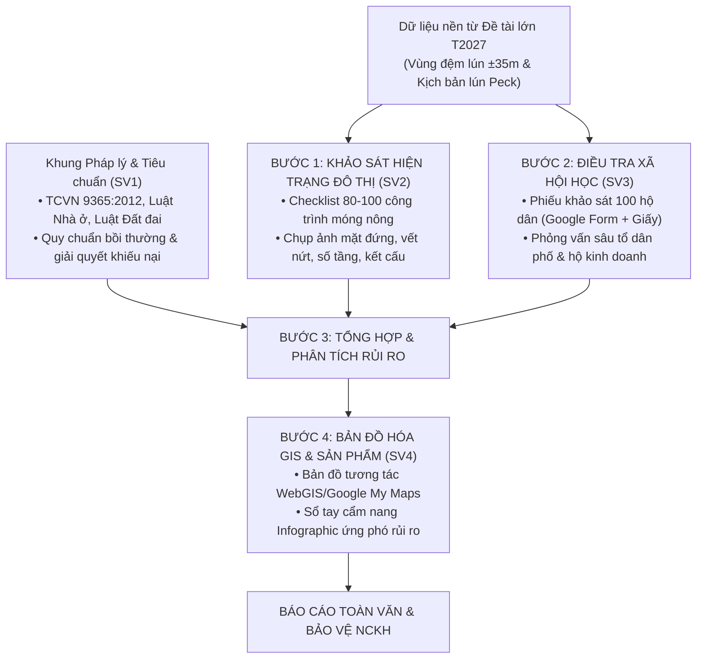

# THUYẾT MINH ĐỀ TÀI NGHIÊN CỨU KHOA HỌC CỦA SINH VIÊN
## NĂM HỌC 2026 – 2027

---

### THÔNG TIN CHUNG VỀ ĐỀ TÀI

* **Tên đề tài:**  
  **"Đánh giá mức độ tổn thương của nhà ở dân cư móng nông và đề xuất giải pháp quản lý rủi ro đô thị dọc hành lang thi công hầm Metro Line 3 (Đoạn Kim Mã – Cát Linh – Văn Miếu)"**
* **Mã số đề tài:** *SV-2026-QLDT-01*
* **Lĩnh vực nghiên cứu:** Quản lý Đô thị / Đánh giá Tác động Môi trường & Quản lý Xây dựng
* **Thời gian thực hiện:** 08 tháng (Từ tháng 11/2026 đến tháng 06/2027)
* **Đơn vị chủ trì:** Khoa / Bộ môn Quản lý Đô thị & Công trình
* **Giảng viên hướng dẫn (Tổng thầu khoa học):** TS. Nguyễn Hải Hà (Chủ nhiệm Đề tài T2027 TBM_ĐTM)
* **Nhóm sinh viên thực hiện (Nhóm 4 sinh viên nữ – Lớp Quản lý Đô thị K67/K68):**
  1. **Sinh viên 1 (Trưởng nhóm):** Điều phối tiến độ, khung thể chế chính sách, quy chuẩn QCVN/TCVN, tổng hợp báo cáo.
  2. **Sinh viên 2:** Kỹ thuật khảo sát hiện trạng công trình, lập bảng kiểm (checklist) nhà ở móng nông, đánh giá cấp độ tổn thương kết cấu.
  3. **Sinh viên 3:** Điều tra xã hội học đô thị, thiết kế phiếu khảo sát cộng đồng, phân tích dữ liệu thống kê (SPSS/Excel), đánh giá sinh kế và nhận thức rủi ro.
  4. **Sinh viên 4:** Bản đồ học đô thị, xây dựng cơ sở dữ liệu không gian WebGIS/Google My Maps, thiết kế đồ họa Infographic, cẩm nang truyền thông và slide báo cáo.

---

### PHẦN I: TÍNH CẤP THIẾT VÀ TỔNG QUAN VẤN ĐỀ NGHIÊN CỨU

#### 1.1. Tính cấp thiết của đề tài
1. **Bối cảnh thực tiễn của Dự án Metro Line 3 (Nhổn – Ga Hà Nội):**  
   Dự án Tuyến đường sắt đô thị số 3 Hà Nội đang bước vào giai đoạn quyết định: thi công 4 km đoạn đi ngầm (từ ga S9 Kim Mã đến ga S12 Ga Hà Nội) bằng máy đào hầm cân bằng áp lực đất (EPB-TBM). Quá trình khiên đào đi ngầm dưới lòng đất tất yếu làm giải phóng ứng suất và gây mất thể tích đất ($V_L$), hình thành phễu lún bề mặt (Surface Settlement Trough).
2. **Đặc thù đô thị lịch sử khu vực nội đô:**  
   Hành lang tuyến ngầm đi qua các trục đường huyết mạch (Kim Mã, Cát Linh, Quốc Tử Giám) tập trung dày đặc các công trình nhà ở tư nhân dạng "nhà ống" 3–5 tầng, được xây dựng qua nhiều thời kỳ khác nhau với kết cấu móng nông (móng băng, móng bè gạch/bê tông hoặc thậm chí móng cọc tre gia cố cục bộ). Đây là loại hình kết cấu cực kỳ nhạy cảm với độ lún chênh lệch (Differential Settlement) và độ dốc mặt đất (Angular Distortion).
3. **Khoảng trống dưới góc độ Quản lý Đô thị:**  
   Các nghiên cứu địa kỹ thuật thuần túy thường chỉ dừng lại ở các bài toán cơ học, tính toán ra biên độ lún (mm) hoặc lập mô hình phần tử hữu hạn phức tạp. Tuy nhiên, dưới góc độ **Quản lý Đô thị và Đánh giá Tác động Môi trường - Xã hội (EIA/SIA)**, câu hỏi quan trọng nhất đối với chính quyền đô thị và người dân là:
   * *Bao nhiêu ngôi nhà nằm trong vùng nguy cơ? Mức độ tổn thương của từng loại nhà ra sao?*
   * *Người dân lo ngại điều gì nhất và họ có được thông tin minh bạch hay không?*
   * *Khi xuất hiện vết nứt hoặc hiện tượng lún sụt bất thường, chính quyền phường và người dân cần quy trình ứng phó, ghi nhận hiện trường và yêu cầu bồi thường như thế nào?*
4. Vì vậy, việc thực hiện đề tài là **đặc biệt cấp thiết, có tính thời sự cao**, gắn liền với đời sống dân sinh của Thủ đô và là đề tài nghiên cứu vừa sức, rèn luyện toàn diện năng lực nghề nghiệp cho sinh viên ngành Quản lý Đô thị.

#### 1.2. Tổng quan tình hình nghiên cứu
* **Nghiên cứu quốc tế:** Các phương pháp đánh giá hư hại công trình do đào hầm đã được chuẩn hóa bởi Burland (1995), Mair et al. (1996), Son & Cording (2005) dựa trên tương quan giữa biến dạng ngang, góc xoay công trình và cấp độ hư hại (từ Cấp 0 - Thẩm mỹ nhẹ đến Cấp 5 - Hư hỏng nặng kết cấu).
* **Nghiên cứu trong nước & Kế thừa từ Đề tài lớn T2027:**  
  Đề tài mẹ T2027 đã xác lập các thông số cơ học và tính toán phễu lún Peck (1969), Loganathan & Poulos (1998) dọc 3 đoạn kỹ thuật S9–S10, S10–S11, S11–S12, xác định dải ảnh hưởng lún nguy cơ trong khoảng $\pm 35\,\text{m}$ tính từ tim tuyến hầm. Đề tài NCKHSV này sẽ kế thừa trực tiếp kết quả vùng đệm lún lý thuyết đó để tiến hành nghiên cứu thực chứng ngoài thực địa từ lăng kính quản lý đô thị.

---

### PHẦN II: MỤC TIÊU, ĐỐI TƯỢNG VÀ PHẠM VI NGHIÊN CỨU

#### 2.1. Mục tiêu nghiên cứu
* **Mục tiêu tổng quát:** Nhận diện mức độ tổn thương của nhà ở dân cư móng nông dọc hành lang thi công hầm Metro Line 3 (S9–S11), từ đó xây dựng cơ sở dữ liệu không gian và đề xuất khung quản lý rủi ro đô thị cấp cơ sở (Sổ tay hướng dẫn phối hợp Chủ đầu tư – UBND Phường – Người dân).
* **Mục tiêu cụ thể:**
  1. *Mục tiêu 1:* Khảo sát, phân loại và nhận diện hiện trạng kỹ thuật của 80–100 công trình nhà ở dân cư móng nông đại diện trong dải đệm $\pm 35\,\text{m}$ tim hầm từ ga S9 (Kim Mã) đến ga S11 (Văn Miếu).
  2. *Mục tiêu 2:* Điều tra xã hội học đánh giá nhận thức, mức độ lo ngại, nhu cầu hỗ trợ và sinh kế của ít nhất 100 hộ dân sinh sống và kinh doanh trong vùng ảnh hưởng.
  3. *Mục tiêu 3:* Lập bản đồ số chuyên đề (WebGIS/Google Maps) trực quan hóa mức độ tổn thương công trình theo các kịch bản lún.
  4. *Mục tiêu 4:* Đề xuất Bộ cẩm nang quy trình quản lý rủi ro đô thị và cơ chế phản ánh - giám sát hiện trường thân thiện, dễ áp dụng cho chính quyền cấp phường và cộng đồng cư dân.

#### 2.2. Đối tượng và phạm vi nghiên cứu
* **Đối tượng nghiên cứu:**  
  - Hiện trạng kết cấu và mức độ tổn thương của nhà ở dân cư móng nông.  
  - Tâm lý, nhận thức rủi ro và sinh kế của cộng đồng cư dân đô thị.  
  - Cơ chế, quy chuẩn quản lý trật tự xây dựng và bồi thường thiệt hại công trình lân cận khi thi công hạ tầng ngầm.
* **Phạm vi không gian:**  
  Hành lang tuyến hầm Metro số 3 trong dải đệm $\pm 35\,\text{m}$ từ tim hầm, tập trung vào 2 phân đoạn đại diện:
  - Đoạn S9 – S10: Phố Kim Mã (đoạn qua hồ Thủ Lệ, Đền Voi Phục đến Cát Linh).
  - Đoạn S10 – S11: Tuyến Cát Linh – Hào Nam – Quốc Tử Giám.
* **Phạm vi thời gian:** Số liệu khảo sát và cập nhật thực địa thu thập từ tháng 12/2026 đến tháng 03/2027.

---

### PHẦN III: PHƯƠNG PHÁP NGHIÊN CỨU

Đề tài áp dụng hệ thống phương pháp nghiên cứu liên ngành, được thiết kế chuyên biệt phù hợp với trình độ sinh viên năm thứ nhất:

1. **Phương pháp kế thừa dữ liệu khoa học:** Tiếp nhận kết quả phân tích giải tích phễu lún và mặt bằng tuyến từ Đề tài lớn T2027.
2. **Phương pháp khảo sát điền dã bằng Bảng kiểm (Checklist Field Survey):** Đi dọc tuyến quan sát mặt đứng, ghi nhận quy mô tầng cao, dạng kết cấu (tường chịu lực gạch, khung BTCT móng nông), hiện trạng vết nứt cũ, độ tuổi công trình (ước lượng).
3. **Phương pháp điều tra xã hội học đô thị (Social Survey):** Thiết kế bảng hỏi cấu trúc 15 câu hỏi (nhận thức về dự án Metro, cảm nhận rung chấn, mức độ lo lắng nứt lún, hiểu biết về quyền lợi bồi thường, kênh tiếp nhận thông tin mong muốn).
4. **Phương pháp Bản đồ học và GIS (WebGIS/Mapping):** Số hóa các điểm khảo sát công trình lên nền bản đồ Google My Maps / QGIS, gán các trường thuộc tính (Địa chỉ, số tầng, phân loại rủi ro, ảnh hiện trạng).
5. **Phương pháp chuyên gia và tổng hợp thể chế:** Rà soát Nghị định, Thông tư về quản lý an toàn công trình lân cận khi thi công ngầm đô thị; phỏng vấn ý kiến cán bộ đô thị phường.

---

### PHẦN IV: NỘI DUNG VÀ TIẾN ĐỘ THỰC HIỆN DỰ KIẾN (KẾ HOẠCH BÀN GIAO)

Đề tài được cấu trúc thành 4 chương chính:
* **Chương 1: Tổng quan về Dự án Metro Line 3 và Khung lý thuyết quản lý rủi ro nhà ở trong đô thị lịch sử.**
* **Chương 2: Đặc điểm không gian kiến trúc và Đánh giá mức độ tổn thương của nhà ở dân cư dọc đoạn S9–S11.**
* **Chương 3: Thực trạng nhận thức của cộng đồng và Tác động xã hội - sinh kế do thi công hầm ngầm.**
* **Chương 4: Đề xuất giải pháp quản lý rủi ro đô thị và Xây dựng công cụ hỗ trợ cộng đồng (WebGIS & Cẩm nang).**

---

### PHẦN V: SẢN PHẨM DỰ KIẾN VÀ ĐÓNG GÓP CỦA ĐỀ TÀI

1. **Báo cáo tổng kết toàn văn:** 01 báo cáo khoa học dày 45–60 trang, tuân thủ chặt chẽ thể thức NCKHSV cấp Trường.
2. **Cơ sở dữ liệu không gian & Bản đồ WebGIS:** Bản đồ số hóa hiện trạng rủi ro của 80–100 công trình nhà dân dọc tuyến S9–S11 (tra cứu trực quan trên điện thoại hoặc trình duyệt web).
3. **Ấn phẩm truyền thông ứng dụng thực tế:** 01 Cẩm nang Infographic (Sổ tay 8 trang) *"Hướng dẫn hộ gia đình tự kiểm tra và phối hợp giám sát an toàn nhà ở khi thi công hầm ngầm Metro"*.
4. **Công bố khoa học:** 01 bài báo khoa học đăng trên Kỷ yếu Hội nghị Sinh viên Nghiên cứu Khoa học cấp Trường/Khoa.
5. **Đóng góp phát triển người học:** Nhóm 4 sinh viên nữ năm nhất được đào tạo bài bản về phương pháp NCKH, kỹ năng làm việc nhóm, kỹ năng điều tra thực địa an toàn, tư duy quản lý đô thị thực tiễn và kỹ năng thuyết trình tự tin.
