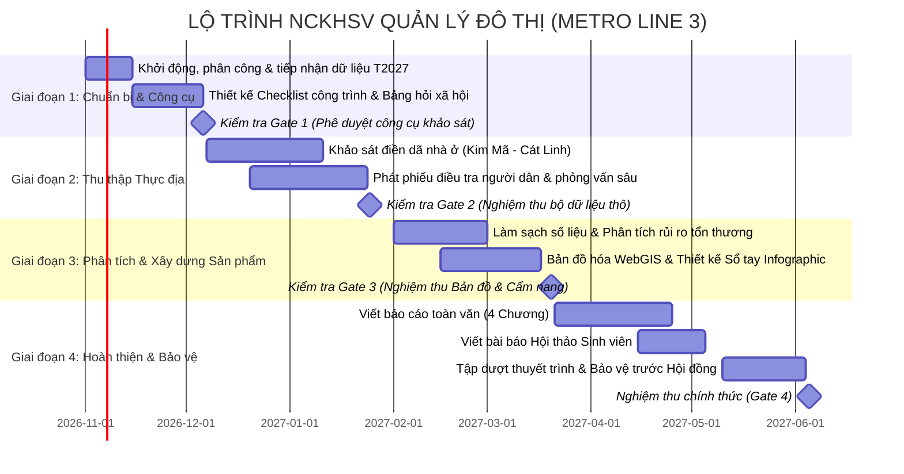

# KẾ HOẠCH TRIỂN KHAI CHI TIẾT VÀ PHÂN CÔNG NHIỆM VỤ NCKHSV
## ĐỀ TÀI: ĐÁNH GIÁ MỨC ĐỘ TỔN THƯƠNG NHÀ Ở MÓNG NÔNG VÀ QUẢN LÝ RỦI RO ĐÔ THỊ (METRO LINE 3 ĐOẠN S9–S11)

---

### I. MÔ HÌNH VẬN HÀNH: TỔNG THẦU KHOA HỌC & 4 THÀNH VIÊN NGHIÊN CỨU

Nhóm nghiên cứu vận hành theo cơ chế mô phỏng dự án thực tế:
* **Giảng viên hướng dẫn (Đóng vai trò "Tổng thầu khoa học"):**
  - Định hướng chiến lược, phê duyệt đề cương, cung cấp dữ liệu nền tảng từ Đề tài lớn T2027.
  - Tổ chức rà soát chất lượng (Quality Gates), phản biện, tháo gỡ khó khăn về mặt pháp lý và phương pháp.
  - Kết nối với chính quyền địa phương, ban quản lý dự án (nếu cần giới thiệu) để bảo đảm an toàn và tính pháp lý cho sinh viên khi điền dã.
* **4 Sinh viên Nữ Năm thứ nhất (Đóng vai trò các "Kỹ sư nghiên cứu chuyên trách"):**
  - **SV1 (Trưởng nhóm - Thể chế & Điều phối):** Giữ nhịp độ dự án, chịu trách nhiệm về tính liên kết, văn phong học thuật và mảng pháp lý/chính sách đô thị.
  - **SV2 (Chuyên trách Khảo sát Kỹ thuật Hiện trạng):** Trực tiếp thiết kế bảng kiểm checklist công trình, dẫn đầu nhóm khảo sát hiện trường, ghi nhận các đặc tính vật lý của nhà ở.
  - **SV3 (Chuyên trách Điều tra Xã hội học & Thống kê):** Thiết kế bảng hỏi, tiếp cận người dân, điều phối thu thập mẫu phiếu khảo sát, phân tích số liệu Excel/SPSS.
  - **SV4 (Chuyên trách Không gian số, GIS & Trực quan hóa):** Xây dựng bản đồ số tương tác (WebGIS / Google Maps), thiết kế Infographic cẩm nang, biên tập đồ họa và bài thuyết trình.

---

### II. BẢNG PHÂN CÔNG TRÁCH NHIỆM MA TRẬN RACI

*Ký hiệu:* **R** = Người trực tiếp làm (Responsible); **A** = Người chịu trách nhiệm phê duyệt/kiểm tra chính (Accountable); **C** = Người tham gia góp ý/hỗ trợ (Consulted); **I** = Người nắm bắt thông tin (Informed).

| STT | Gói công việc (WBS) | SV1 (Trưởng nhóm) | SV2 (Hiện trạng) | SV3 (Xã hội học) | SV4 (GIS/Đồ họa) | Giảng viên (Tổng thầu) |
| :---: | :--- | :---: | :---: | :---: | :---: | :---: |
| **1** | Hoàn thiện Thuyết minh & Đề cương chi tiết | **R / A** | C | C | C | **Phê duyệt (Gate 1)** |
| **2** | Rà soát cơ chế pháp lý, TCVN & Đề tài T2027 | **R** | C | I | I | Hướng dẫn nguồn |
| **3** | Thiết kế Bảng kiểm (Checklist) khảo sát nhà ở | C | **R / A** | C | I | Hiệu đính kỹ thuật |
| **4** | Thiết kế Phiếu điều tra xã hội học (15 câu) | C | C | **R / A** | I | Phê duyệt nội dung |
| **5** | Khảo sát thực địa điền dã (80–100 công trình) | Phụ trách an toàn | **R (Kỹ thuật)** | C (Hỗ trợ) | C (Chụp ảnh) | Giám sát từ xa |
| **6** | Phát phiếu khảo sát người dân (100 phiếu) | C | C | **R (Chính)** | C (Hỗ trợ) | Cấp thư giới thiệu |
| **7** | Làm sạch & Phân tích số liệu khảo sát | C | R (Dữ liệu nhà) | **R (Dữ liệu dân)** | C | Kiểm tra thống kê |
| **8** | Xây dựng Bản đồ số WebGIS / Google My Maps | I | C (Cung cấp tọa độ)| C | **R / A** | Đánh giá trực quan |
| **9** | Thiết kế Cẩm nang Infographic ứng phó rủi ro | C (Nội dung) | C (Kỹ thuật) | C (Truyền thông) | **R / A** | Phê duyệt xuất bản |
| **10**| Soạn thảo Báo cáo toàn văn NCKH | **R / A** | R (Chương 2) | R (Chương 3) | R (Chương 4) | **Phản biện & Sửa chữa** |
| **11**| Thiết kế Slide & Luyện tập bảo vệ đề tài | C | C | C | **R (Thiết kế)** | **Tổ chức báo cáo thử** |

---

### III. LỘ TRÌNH TRIỂN KHAI THEO 4 GIAI ĐOẠN (TIMELINE 8 THÁNG)

---

### IV. HỆ THỐNG CÁC CỔNG KIỂM SOÁT CHẤT LƯỢNG (AUDIT GATES CỦA TỔNG THẦU)

* **Gate 1 (Hoàn thiện công cụ - Tuần 4):**
  - *Yêu cầu:* Thuyết minh được phê duyệt; Bảng kiểm checklist hiện trạng nhà ở đạt tiêu chuẩn dễ hiểu, dễ quan sát; Bảng hỏi khảo sát cộng đồng có câu từ lịch sự, bảo mật thông tin cá nhân.
* **Gate 2 (Nghiệm thu dữ liệu thực địa - Tuần 11):**
  - *Yêu cầu:* Đủ tối thiểu 80 phiếu checklist nhà ở kèm ảnh hiện trường có gắn thẻ định vị/địa chỉ rõ ràng; tối thiểu 100 phiếu điều tra xã hội học hợp lệ; bảng Excel nhập liệu sạch, không khuyết thiếu thông tin trọng yếu.
* **Gate 3 (Nghiệm thu sản phẩm số & Cẩm nang - Tuần 18):**
  - *Yêu cầu:* Bản đồ WebGIS hoạt động trơn tru trên điện thoại/máy tính, hiển thị rõ các lớp: Tim tuyến Metro, Vùng đệm 35m, Điểm nhà ở được phân màu rủi ro; Cẩm nang Infographic thiết kế chuyên nghiệp, màu sắc hài hòa, thông điệp ngắn gọn.
* **Gate 4 (Nghiệm thu Báo cáo toàn văn & Bảo vệ thử - Tuần 28):**
  - *Yêu cầu:* Báo cáo toàn văn hoàn chỉnh không lỗi chính tả, trích dẫn chuẩn APA; Slide bảo vệ súc tích (15–20 slides); nhóm trả lời trôi chảy các câu hỏi phản biện của Giảng viên.

---

### V. NGUYÊN TẮC LÀM VIỆC NHÓM & VĂN HÓA HỌC THUẬT

1. **Giao ban định kỳ (Weekly Standup):** Mỗi tối Chủ nhật, nhóm họp trực tuyến 30 phút với Giảng viên để báo cáo 3 câu hỏi: *(1) Tuần qua đã làm được gì? (2) Đang gặp khó khăn gì? (3) Kế hoạch tuần tới là gì?*
2. **An toàn thực địa là số 1:** Khi đi khảo sát thực tế dọc các tuyến đường Kim Mã, Cát Linh, nhóm phải đi cùng nhau (tối thiểu 2 bạn/cặp), mặc trang phục lịch sự, đeo thẻ sinh viên, mang theo Giấy giới thiệu có dấu của Khoa/Bộ môn, chỉ quan sát và chụp ảnh từ không gian công cộng ngoài vỉa hè (không tự ý xâm nhập vào nhà dân khi chưa được đồng ý).
3. **Trung thực trong nghiên cứu khoa học:** Tuyệt đối không tự bịa số liệu khảo sát, không tự điền phiếu hỏi. Mọi quan sát hiện trường đều phải có ảnh chụp đối chứng làm minh chứng khoa học.
